<div dir="rtl">

# 🔐 SecureVoice — نظام الاتصال الصوتي الآمن المعتمد على خوارزميات التشفير خفيفة الوزن

**Secure Voice Communication System Based on Lightweight Encryption Algorithms**

> مشروع تخرج متكامل: برنامج سطح مكتب لنظام **Windows** يُجري **مكالمة صوتية حيّة مشفرة** بين جهازين على نفس الشبكة،
> باستخدام خوارزمية **Ascon-128** (الفائزة بمسابقة NIST للتشفير خفيف الوزن 2023، وأساس المعيار NIST SP 800-232)
> مكتوبة بالكامل داخل المشروع، مع تبادل مفاتيح **X25519** ومصادقة بكلمة سر وحماية من التعديل والتزوير وإعادة الإرسال.

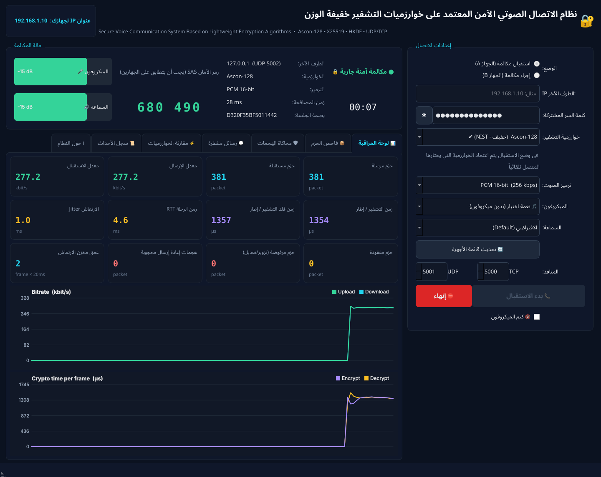

</div>

<div dir="rtl">

## 📑 المحتويات

1. [ما هو المشروع؟](#-ما-هو-المشروع)
2. [المميزات](#-المميزات)
3. [صور البرنامج](#-صور-البرنامج)
4. [التشغيل السريع على Windows (خطوة بخطوة)](#-التشغيل-السريع-على-windows-خطوة-بخطوة)
5. [كيفية الاتصال بين الجهازين](#-كيفية-الاتصال-بين-الجهازين)
6. [كيف يعمل النظام؟ (المخططات)](#-كيف-يعمل-النظام-المخططات)
7. [طريقة نقل الصوت وتشفيره والقناة الناقلة](#-طريقة-نقل-الصوت-وتشفيره-والقناة-الناقلة)
8. [النتائج والقياسات](#-النتائج-والقياسات)
9. [الاختبارات](#-الاختبارات)
10. [هيكل المشروع](#-هيكل-المشروع)
11. [التوثيق الكامل](#-التوثيق-الكامل)
12. [حل المشاكل](#-حل-المشاكل-الشائعة)

---

## 🎯 ما هو المشروع؟

الاتصالات الصوتية عبر الشبكات (VoIP) معرضة للتنصت والتلاعب. المشروع يبني نظاماً كاملاً يضمن أن الصوت المنتقل بين جهازين:

| الهدف الأمني | كيف تحقق في المشروع |
|---|---|
| **السرية** — لا يفهمه المتنصت | تشفير كل إطار صوتي بـ **Ascon-128** (أو ChaCha20-Poly1305 / AES-128-GCM للمقارنة) |
| **السلامة** — لا يمكن تعديله | وسم مصادقة **128 بت** لكل حزمة (تشفير موثّق AEAD) |
| **الأصالة** — لا يمكن تزويره | مفاتيح لا يعرفها إلا الطرفان + مصادقة متبادلة بكلمة سر |
| **منع إعادة الإرسال** | رقم تسلسل لكل حزمة + نافذة انزلاقية 64 حزمة |
| **السرية الأمامية** | مفاتيح **X25519** مؤقتة جديدة لكل مكالمة |
| **الأداء الآني** | تشفير الإطار ≈ 1.2ms من أصل 20ms متاحة + تأخير كلي ≈ 100ms |

**لماذا "خفيف الوزن"؟** خوارزميات مثل Ascon صُممت للأجهزة محدودة الموارد (إنترنت الأشياء، الهواتف البسيطة، الأجهزة العسكرية المحمولة):
حالة داخلية صغيرة (320 بت)، عمليات بسيطة (AND/XOR/NOT/تدوير)، لا تحتاج جداول بحث (مقاومة لهجمات التوقيت)، ومساحة صغيرة في العتاد.

---

## ✨ المميزات

- 🖥 **برنامج سطح مكتب بواجهة عربية كاملة** (PySide6/Qt) — يعمل على Windows 10/11 كملف `.exe` أو عبر Python.
- 📞 **مكالمة صوتية حيّة في الاتجاهين** بين جهازين (ميكروفون ← سماعة) بجودة 16kHz.
- 🔐 **Ascon-128 مكتوب من الصفر** في [`securevoice/crypto/ascon.py`](securevoice/crypto/ascon.py) ومُتحقق منه بمتجهات الاختبار الرسمية.
- ⚖ **3 خوارزميات قابلة للاختيار والمقارنة**: Ascon-128، ChaCha20-Poly1305، AES-128-GCM.
- 🤝 **مصافحة آمنة**: X25519 + PBKDF2 + HKDF-SHA256 + Finished MAC + رمز أمان SAS من 6 أرقام.
- 🎚 **ترميزان للصوت**: PCM 16-bit (256 kbps) و G.711 μ-law (128 kbps).
- 📊 **لوحة مراقبة حيّة**: الحزم، معدل البت، زمن التشفير، RTT، الارتعاش، الفقد، رسوم بيانية.
- 📦 **فاحص الحزم**: يعرض النص الأصلي والمشفّر والـ Nonce والوسم لكل حزمة.
- 🛡 **محاكاة الهجمات** أمام اللجنة: تعديل، تزوير، إعادة إرسال، وضع المتنصت (سماع النص المشفر)، كلمة سر خاطئة.
- 💬 **رسائل نصية مشفرة** عبر قناة التحكم.
- ⚡ **مقارنة أداء الخوارزميات** مدمجة في البرنامج.
- 🎵 **نغمة اختبار** بدل الميكروفون (للعرض على جهاز بدون ميكروفون).
- ✅ **48 اختباراً آلياً** تشمل مكالمات حقيقية عبر الشبكة.

---

## 📸 صور البرنامج

### 1) الشاشة الرئيسية — الجهاز A (وضع الاستقبال) والجهاز B (وضع الاتصال)

| الجهاز A: استقبال مكالمة | الجهاز B: إجراء مكالمة |
|---|---|
| 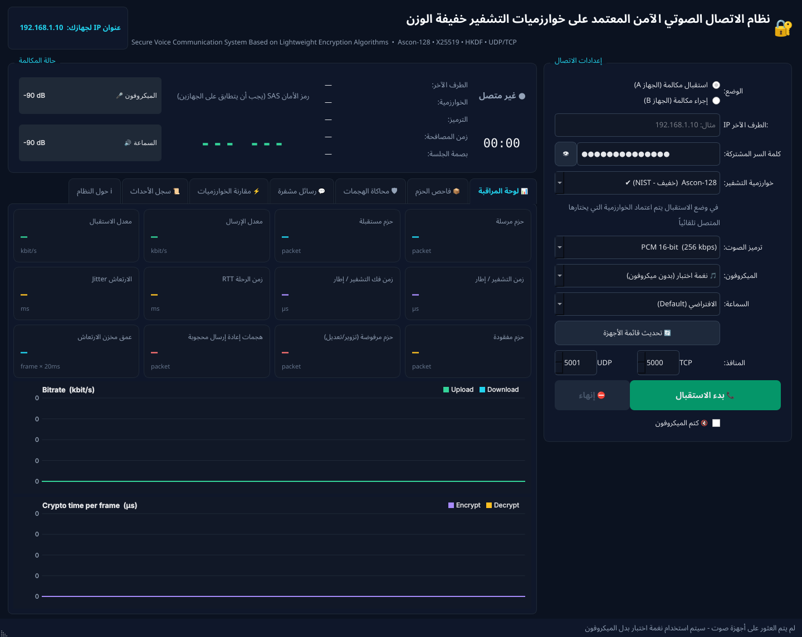 | 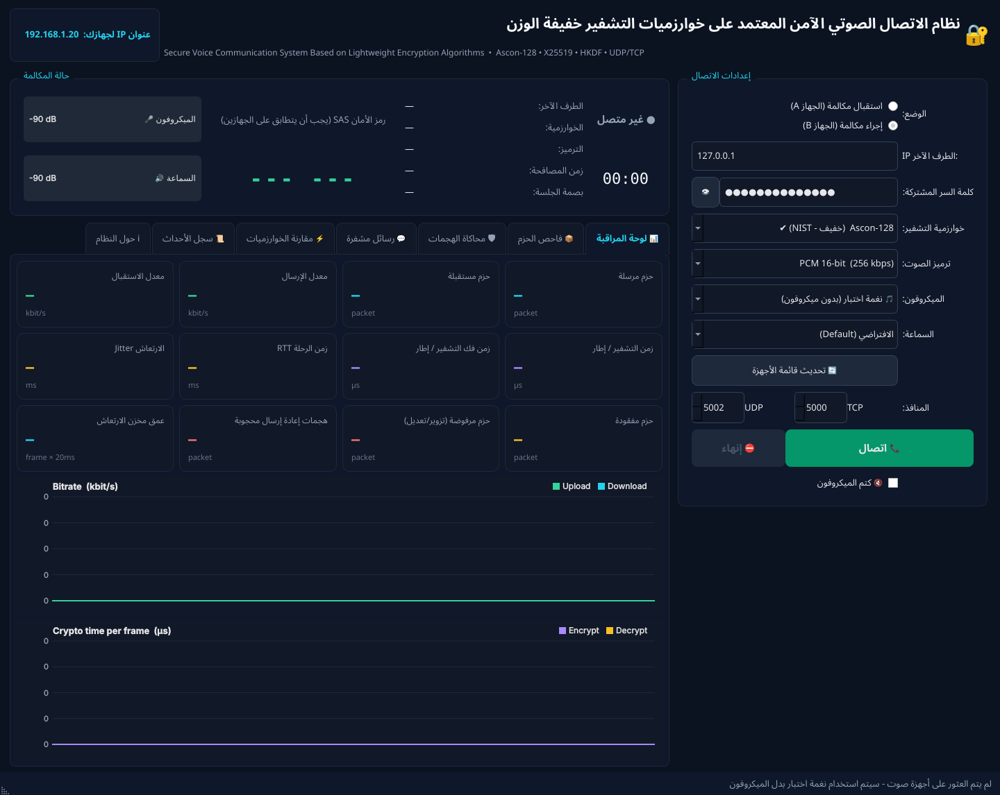 |

### 2) الجهاز A بانتظار المكالمة

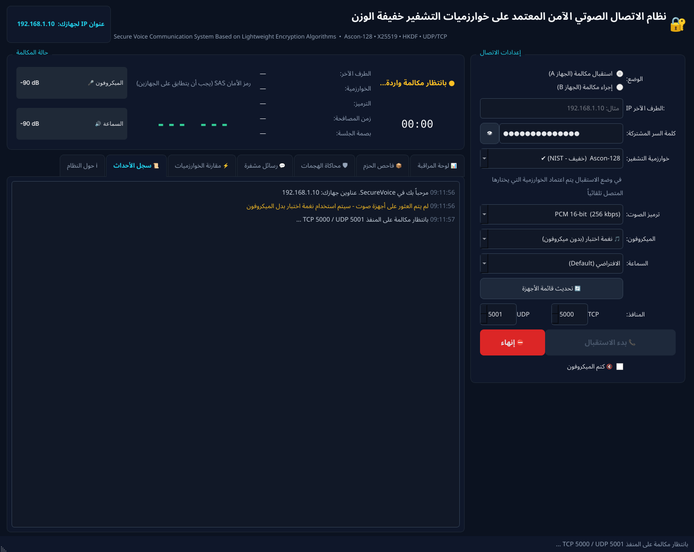

### 3) المكالمة الآمنة جارية — لاحظ رمز الأمان المتطابق على الجهازين

| الجهاز A | الجهاز B |
|---|---|
|  | 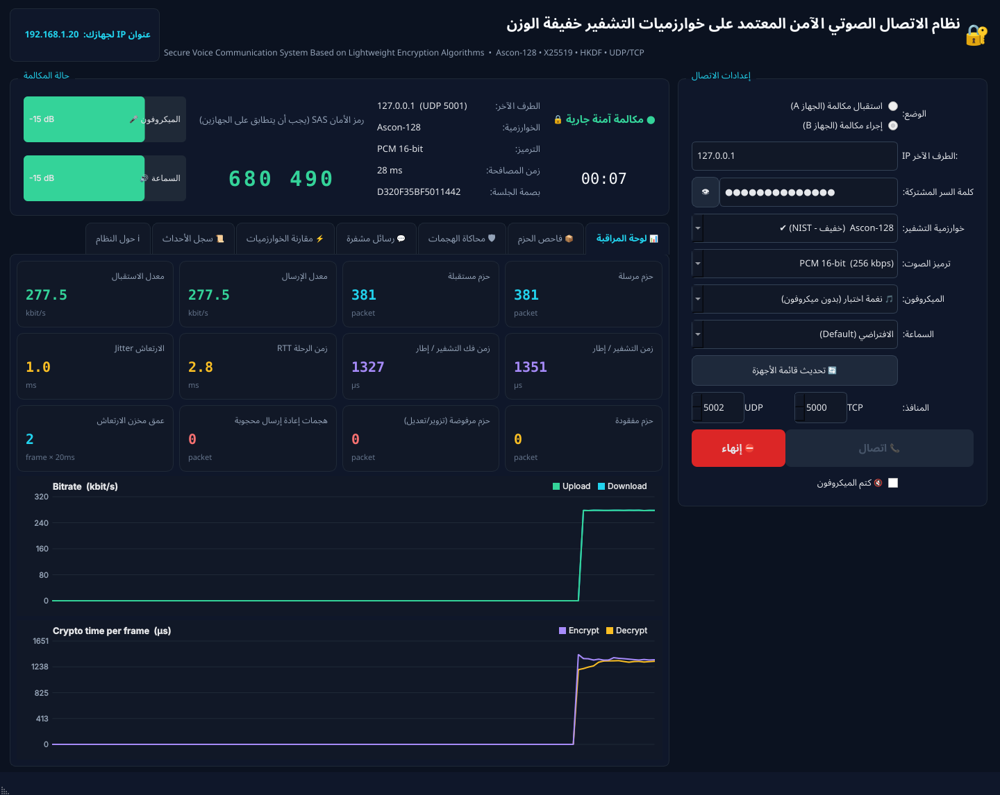 |

### 4) فاحص الحزم — النص الأصلي مقابل النص المشفر والوسم لكل حزمة

| كل الحزم (عينة كل 10 حزم) | فلتر «المرفوضة فقط» بعد الهجمات: AUTH FAIL و REPLAY |
|---|---|
| 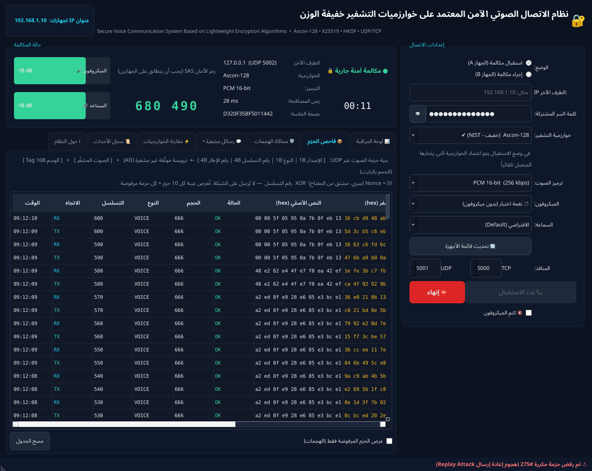 | 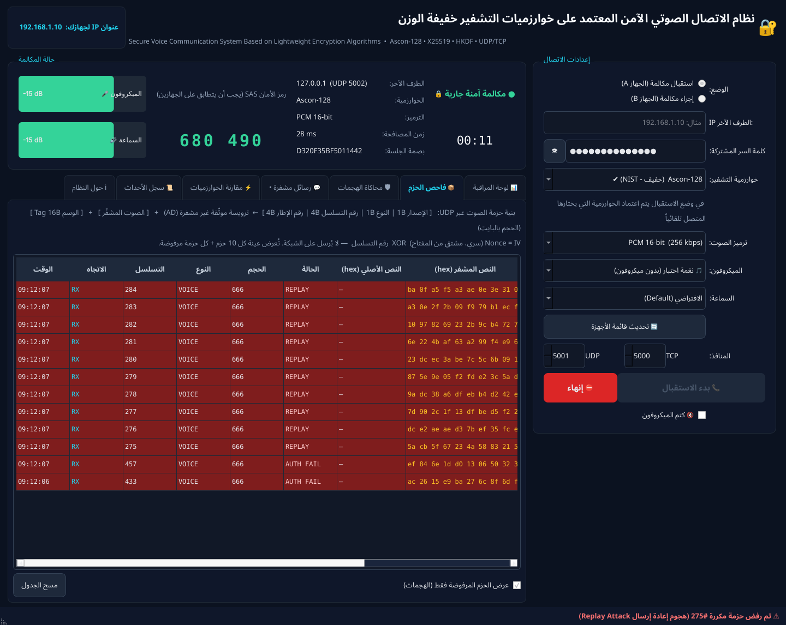 |

### 5) محاكاة الهجمات (من الجهاز B) ونتيجتها في سجل الجهاز A

| أدوات الهجوم على الجهاز B | الجهاز A يكتشف ويرفض |
|---|---|
| 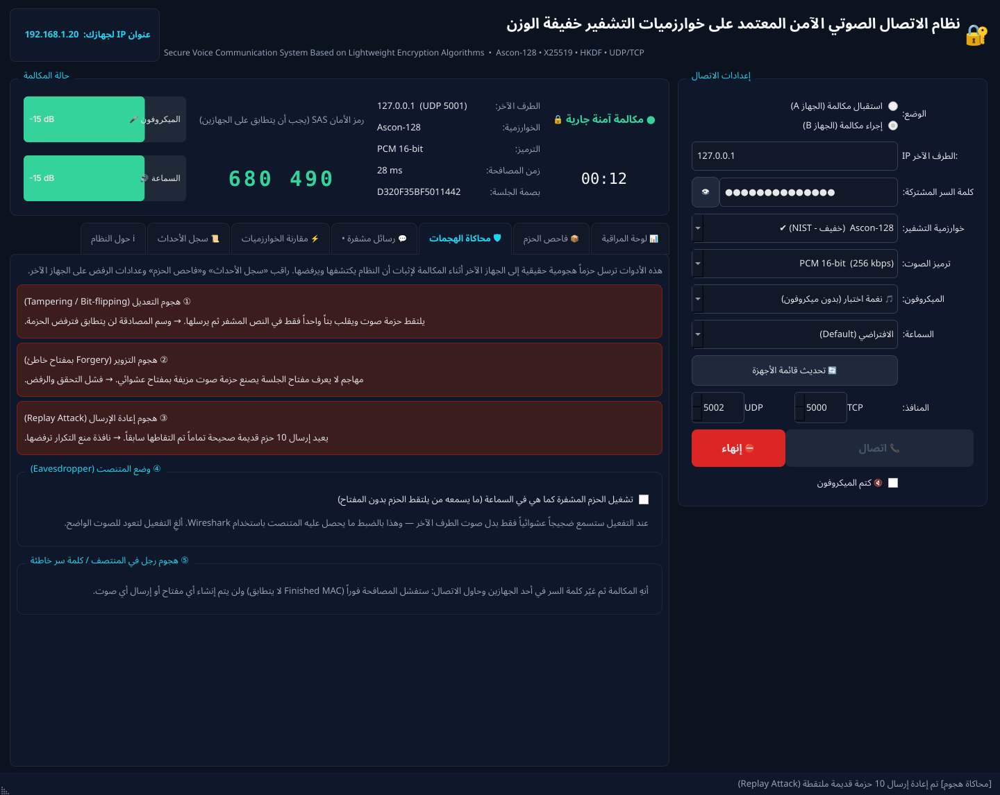 | 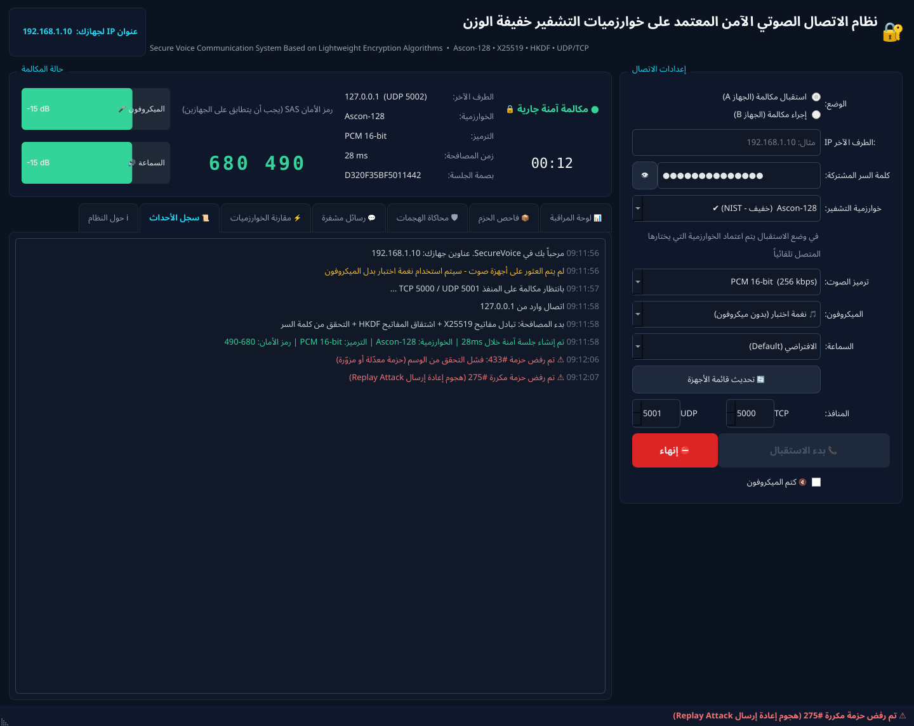 |

### 6) لوحة المراقبة بعد الهجمات (العدادات الحمراء) + الرسائل المشفرة

| المراقبة | الرسائل المشفرة |
|---|---|
| 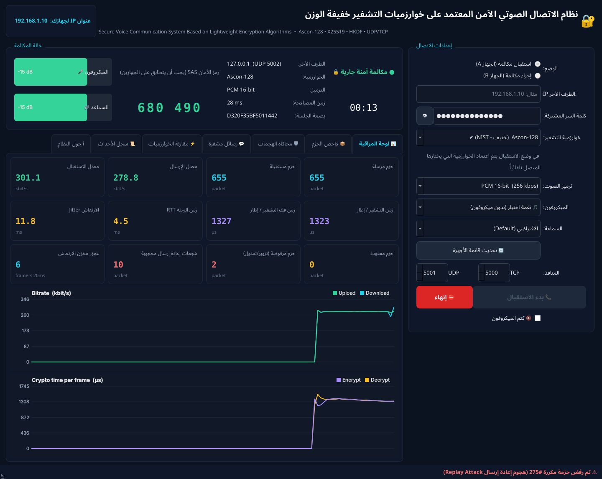 | 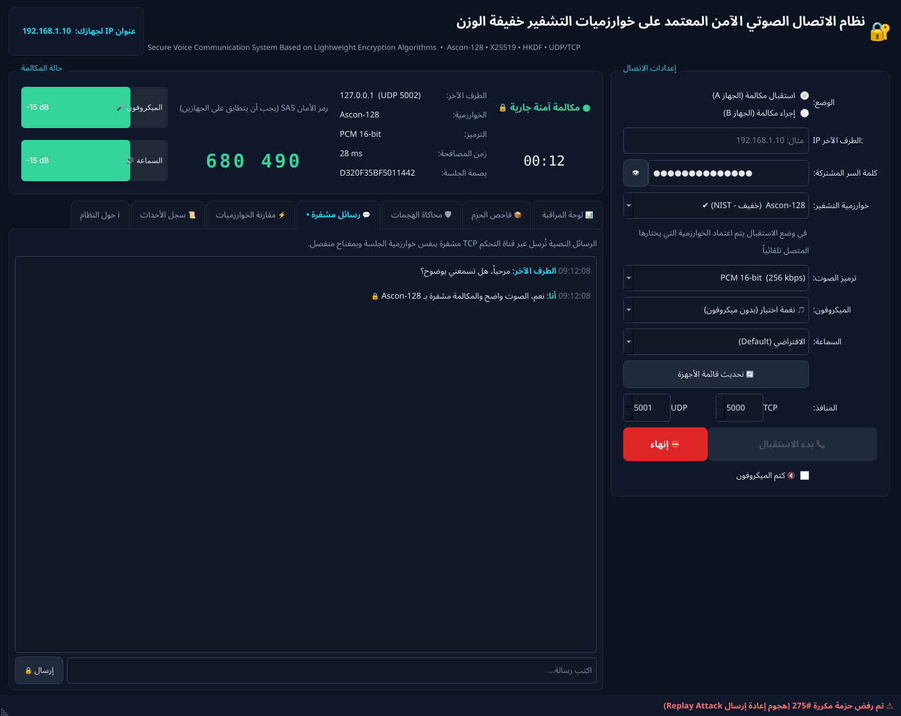 |

### 7) مقارنة أداء الخوارزميات داخل البرنامج

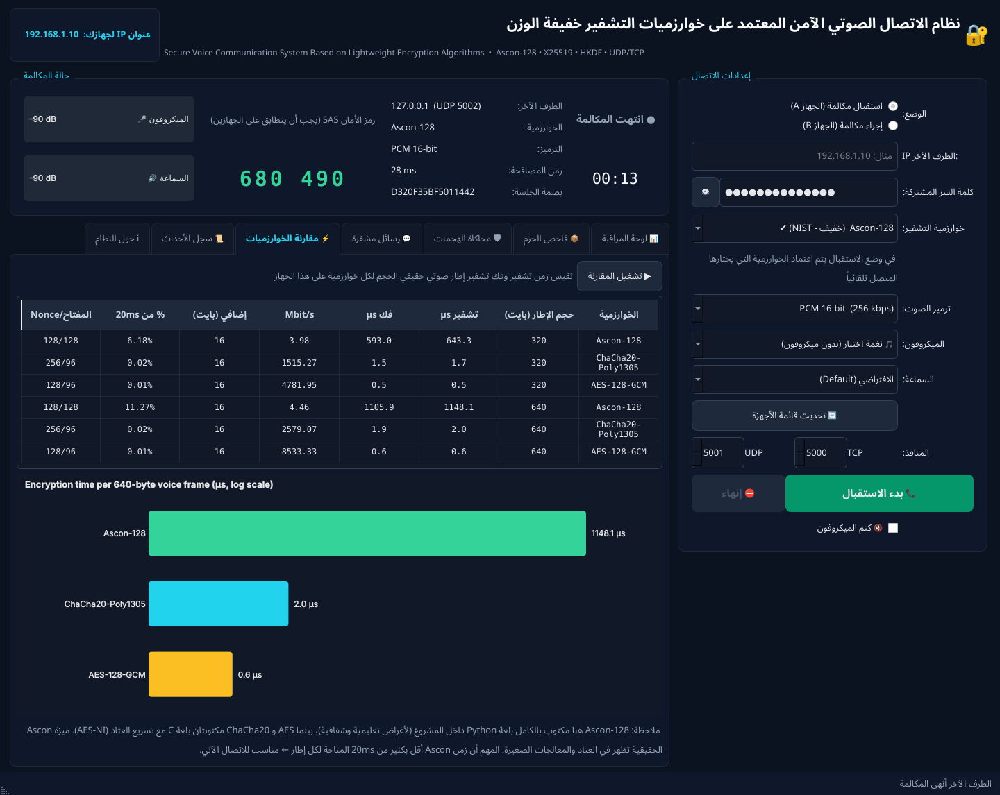

### 8) كلمة سر خاطئة — المصافحة تفشل على الطرفين ولا يُرسل أي صوت

| الجهاز B (المتصل) | الجهاز A (المستقبل) |
|---|---|
| 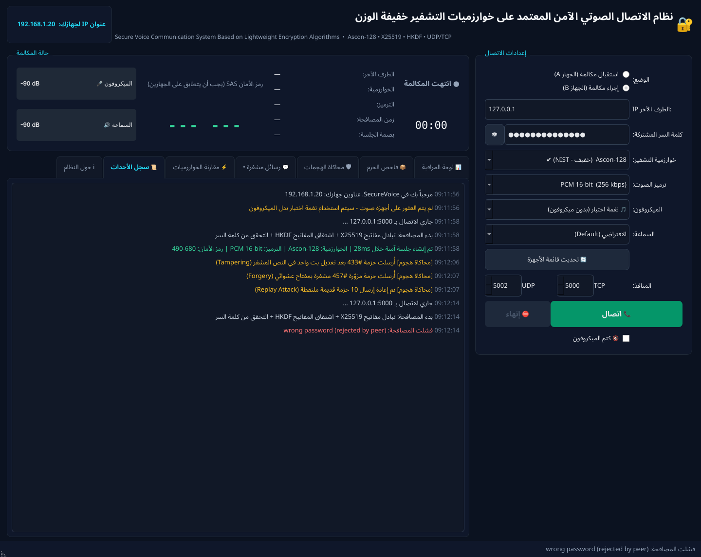 | 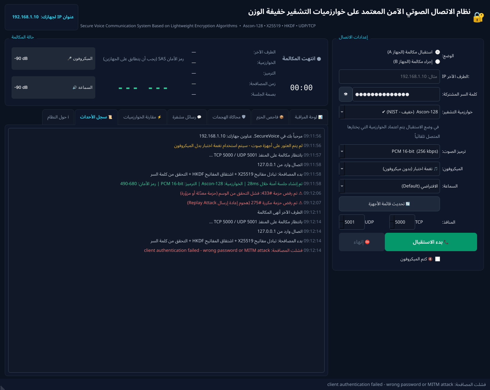 |

---

## 🚀 التشغيل السريع على Windows (خطوة بخطوة)

> كرر الخطوات 1 إلى 4 على **الجهازين**.

### الطريقة الأولى (الأسهل): البرنامج الجاهز `.exe`

1. من صفحة المستودع على GitHub افتح تبويب **Actions** ← آخر تشغيل ناجح لـ **Test & Build Windows EXE** ← نزّل **SecureVoice-Windows** من قسم Artifacts
   (أو من **Releases** إن وُجد إصدار).
2. فك الضغط وشغّل `SecureVoice\SecureVoice.exe`. لا يحتاج تثبيت Python.

### الطريقة الثانية: التشغيل من الكود المصدري

**الخطوة 1 — تثبيت Python**
- نزّل Python 3.10 أو أحدث من <https://www.python.org/downloads/>
- ⚠️ أثناء التثبيت فعّل خيار **Add python.exe to PATH**.

**الخطوة 2 — تنزيل المشروع**
- من GitHub: زر **Code ← Download ZIP** ثم فك الضغط (مثلاً في `C:\SecureVoice`)، أو:

</div>

```bash
git clone https://github.com/blackangiliq/norhan_graduate_project.git
```

<div dir="rtl">

**الخطوة 3 — التثبيت:** انقر نقراً مزدوجاً على **`install.bat`** (ينشئ بيئة `.venv` ويثبت المكتبات: PySide6، cryptography، numpy، sounddevice).

**الخطوة 4 — فتح الجدار الناري:** انقر على **`firewall.bat`** ووافق على صلاحيات المسؤول (يفتح TCP 5000 و UDP 5001-5002).
> عند أول تشغيل قد يظهر أيضاً تنبيه Windows Defender Firewall ← اختر **Allow access** للشبكات الخاصة والعامة.

**الخطوة 5 — التشغيل:** انقر على **`run.bat`** (أو `run_console.bat` لرؤية الأخطاء إن وُجدت).

| الملف | الوظيفة |
|---|---|
| `install.bat` | تثبيت المتطلبات في بيئة افتراضية |
| `run.bat` | تشغيل البرنامج |
| `run_console.bat` | تشغيل مع نافذة أوامر لعرض الأخطاء |
| `firewall.bat` | فتح المنافذ في جدار Windows الناري (كمسؤول) |
| `run_tests.bat` | تشغيل جميع الاختبارات الآلية |
| `build_exe.bat` | بناء `SecureVoice.exe` مستقل بـ PyInstaller |

---

## 📞 كيفية الاتصال بين الجهازين

### تجهيز الشبكة
- اربط الجهازين بـ **نفس شبكة Wi-Fi** أو بنفس الراوتر بكابل، أو استخدم **نقطة اتصال (Hotspot) من الهاتف** — وهي الأضمن يوم المناقشة لأن بعض شبكات الجامعات تعزل الأجهزة عن بعضها.
- عنوان IP لكل جهاز يظهر **أعلى يسار البرنامج** (أو بالأمر `ipconfig` ← IPv4 Address).
- للتأكد من وصول الجهازين لبعضهما: من الجهاز B نفّذ `ping 192.168.1.10` (عنوان A).

### خطوات المكالمة

```
┌──────────────────────────── الجهاز A ─────────────────────────┐   ┌──────────────────────────── الجهاز B ─────────────────────────┐
│ 1. الوضع: «استقبال مكالمة (الجهاز A)»                          │   │ 3. الوضع: «إجراء مكالمة (الجهاز B)»                            │
│ 2. كلمة السر: mykey123   ← اضغط «📞 بدء الاستقبال»             │   │ 4. IP الطرف الآخر: 192.168.1.10   (عنوان A)                    │
│    الحالة تصبح: «بانتظار مكالمة واردة...»                     │   │ 5. كلمة السر: mykey123 (نفسها)  + اختر Ascon-128              │
│                                                               │   │ 6. اضغط «📞 اتصال»                                             │
│ 7. ✅ «مكالمة آمنة جارية 🔒»  رمز الأمان: 645 598              │◄─►│ 7. ✅ «مكالمة آمنة جارية 🔒»  رمز الأمان: 645 598              │
└───────────────────────────────────────────────────────────────┘   └───────────────────────────────────────────────────────────────┘
```

8. **قارنا رمز الأمان** بصوتكما: إذا تطابق فلا يوجد وسيط بينكما.
9. تكلّم! استخدم **سماعات رأس** لتجنب الصدى. راقب لوحة المراقبة وفاحص الحزم.
10. للإنهاء: زر **⛔ إنهاء** على أي جهاز ← تنتهي المكالمة على الطرفين.

> 💡 **تجربة على جهاز واحد:** شغّل البرنامج مرتين. الأولى «استقبال». الثانية «اتصال» إلى `127.0.0.1` مع تغيير منفذ **UDP إلى 5002**.
> وإن لم يوجد ميكروفون اختر «🎵 نغمة اختبار».

---

## 🧠 كيف يعمل النظام؟ (المخططات)

> جميع المخططات موجودة أيضاً كصور عالية الدقة في [`docs/images/diagrams/`](docs/images/diagrams) لاستخدامها في التقرير، ومصدرها في [`docs/diagrams/`](docs/diagrams).

### المعمارية العامة

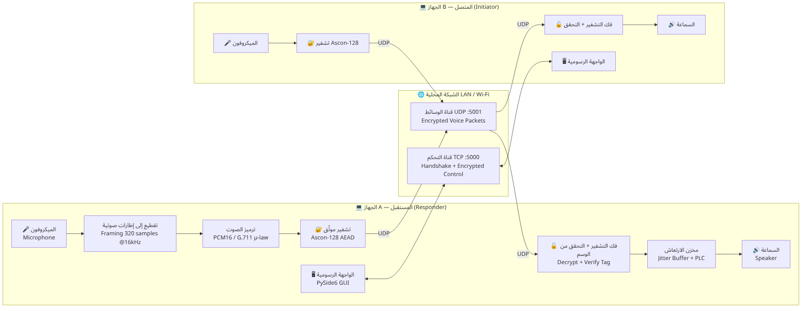

### مخطط سير البرنامج (Flowchart)

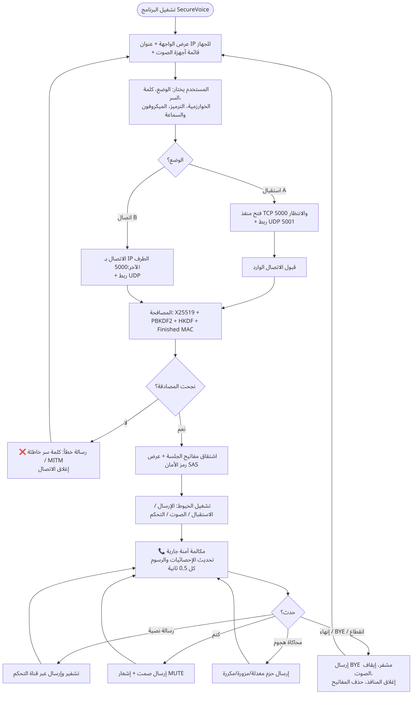

### بروتوكول المصافحة وتبادل المفاتيح (Sequence Diagram)

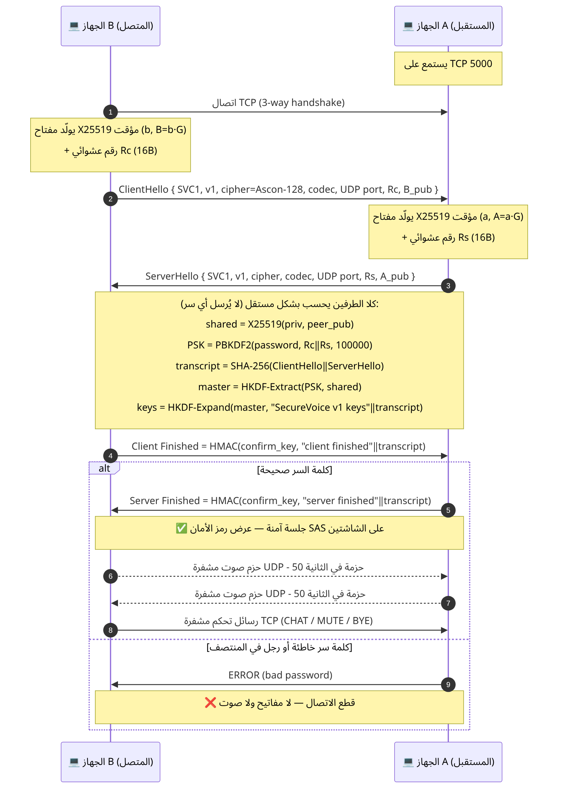

### اشتقاق المفاتيح

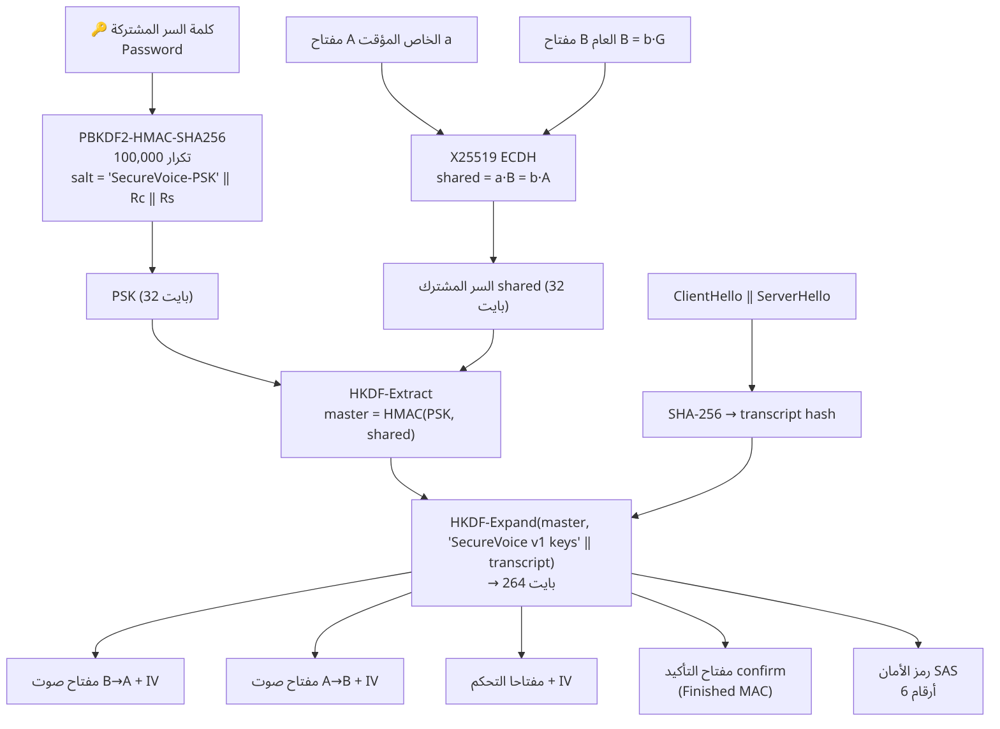

### مخطط الإرسال ومخطط الاستقبال

| الإرسال (Sender) | الاستقبال (Receiver) |
|---|---|
| 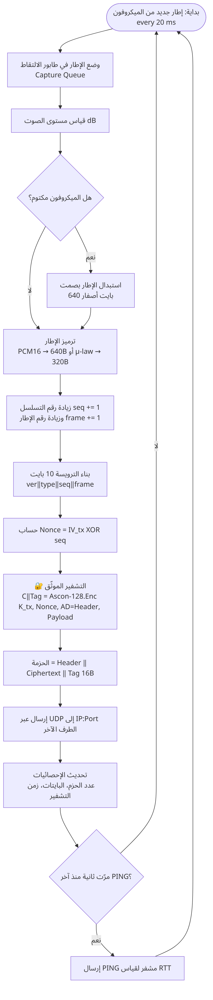 | 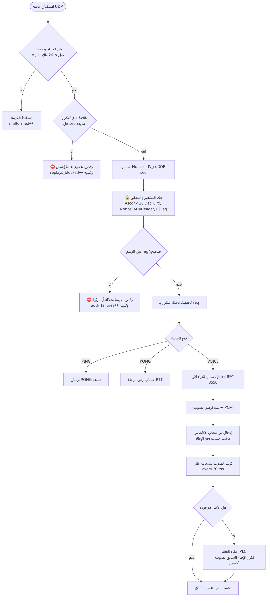 |

### حالات المكالمة (State Machine) والخيوط (Threads)

| حالات المكالمة | الخيوط |
|---|---|
| 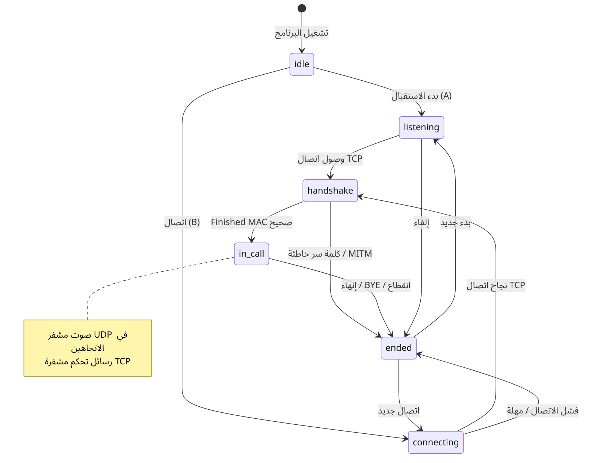 | 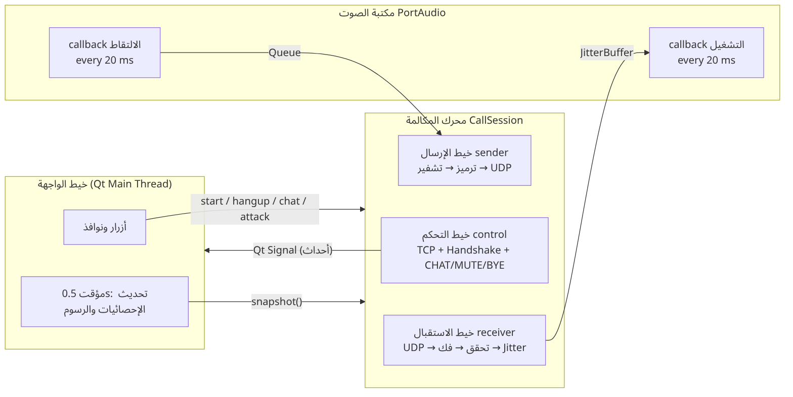 |

### بنية خوارزمية Ascon-128

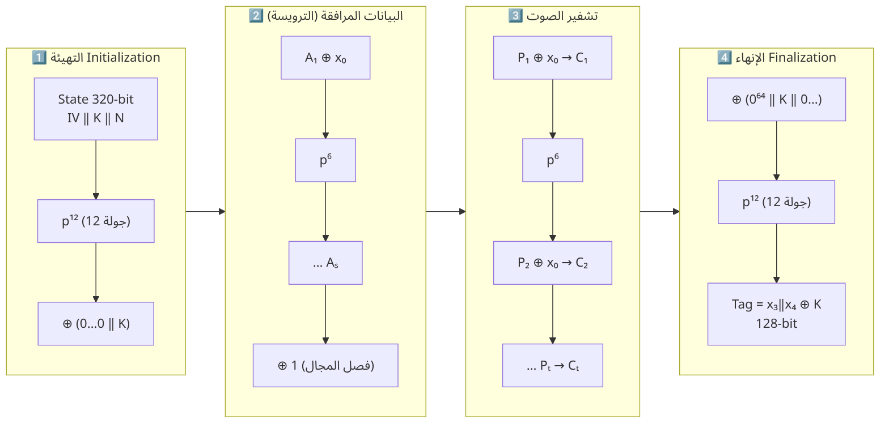

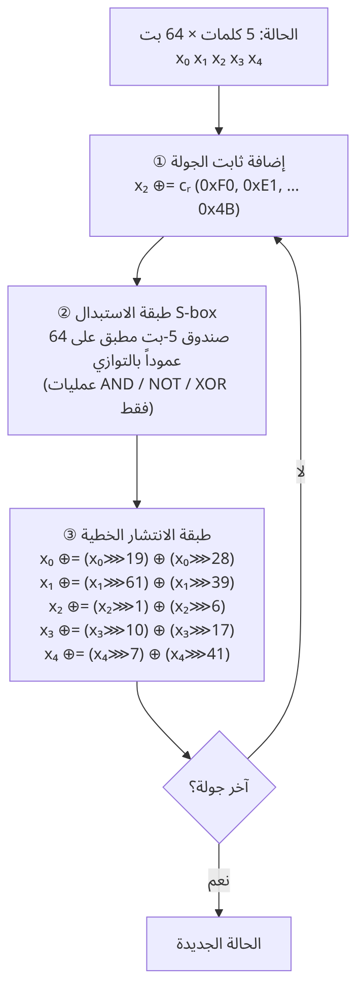

### نموذج التهديد والحماية

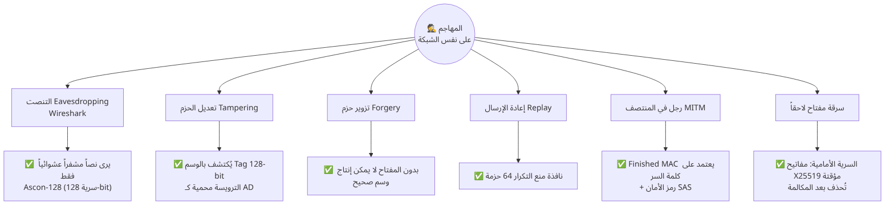

---

## 📡 طريقة نقل الصوت وتشفيره والقناة الناقلة

### القناتان بين الجهازين

| القناة | البروتوكول | المنفذ | الوظيفة | لماذا هذا البروتوكول؟ |
|---|---|---|---|---|
| **قناة التحكم** | TCP | 5000 | المصافحة وتبادل المفاتيح، ثم رسائل مشفرة: CHAT / MUTE / BYE | تحتاج وصولاً مضموناً ومرتباً |
| **قناة الوسائط** | UDP | 5001 (و 5002) | حزم الصوت المشفرة (50 حزمة/ثانية لكل اتجاه) + PING/PONG | الصوت الحي يفضّل السرعة على إعادة الإرسال؛ الحزمة المتأخرة لا قيمة لها |

### رحلة الصوت من الميكروفون إلى السماعة

</div>

```
 🎤 ميكروفون ──► PortAudio يلتقط 320 عينة كل 20ms (16kHz, 16-bit, Mono) = 640 بايت
      │
      ▼
 ترميز الصوت ───► PCM16: 640 بايت   أو   G.711 μ-law: 320 بايت
      │
      ▼
 seq = seq + 1  ;  Nonce = IV_tx ⊕ seq          (IV سري مشتق من المصافحة، لا يُرسل)
 Header = [ver=1 | type=VOICE | seq (4B) | frame# (4B)]          (10 بايت)
      │
      ▼
 🔐 Ascon-128.Encrypt(K_tx, Nonce, AD = Header, Payload)  ──►  Ciphertext ‖ Tag(16B)
      │
      ▼
 UDP Packet = Header(10) ‖ Ciphertext(640) ‖ Tag(16) = 666 بايت  ─────────►  الشبكة
                                                                              │
 ◄────────────────────────────────────────────────────────────────────────────┘
      │
      ▼
 فحص البنية ──► نافذة منع التكرار (seq جديد؟) ──► Nonce = IV_rx ⊕ seq
      │
      ▼
 🔓 Ascon-128.Decrypt + التحقق من الوسم  ──► فشل؟ ⛔ رفض الحزمة + تنبيه
      │ نجاح
      ▼
 فك الترميز ──► مخزن الارتعاش (ترتيب + انتظار 60ms + إخفاء الفقد) ──► 🔊 سماعة
```

<div dir="rtl">

### بنية حزمة الصوت

| البايت | الحقل | الحجم | مشفر؟ | موثّق؟ |
|---|---|---|---|---|
| 0 | الإصدار Version = 1 | 1 | ❌ | ✅ (AD) |
| 1 | النوع: 1=VOICE، 2=PING، 3=PONG | 1 | ❌ | ✅ (AD) |
| 2–5 | رقم التسلسل Sequence (يحدد الـ Nonce) | 4 | ❌ | ✅ (AD) |
| 6–9 | رقم الإطار الصوتي (للترتيب والارتعاش) | 4 | ❌ | ✅ (AD) |
| 10–… | الصوت المشفر | 640 أو 320 | ✅ | ✅ |
| آخر 16 | الوسم Tag | 16 | — | — |

**الشرح الكامل بالتفاصيل الدقيقة** (كل بايت، كل مفتاح، كل خيط): [`docs/04_protocol_and_transport.md`](docs/04_protocol_and_transport.md)

---

## 📈 النتائج والقياسات

### زمن التشفير لكل إطار صوتي

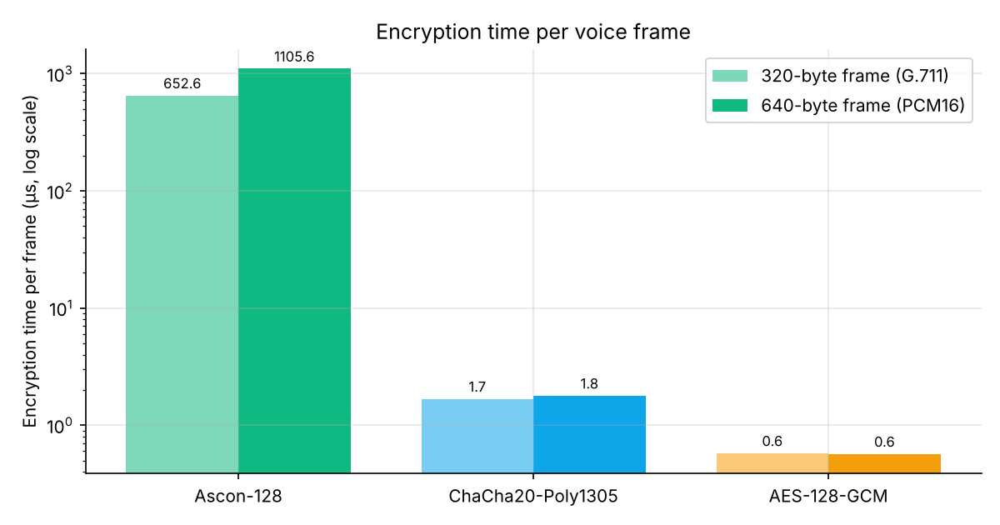

| الخوارزمية | زمن تشفير إطار 640B | النسبة من زمن الإطار (20ms) | ملاحظات |
|---|---|---|---|
| **Ascon-128** (Python خالص — مكتوب في المشروع) | ≈ 1.2 ms | ≈ 11% | ✅ مناسب للزمن الحقيقي بهامش كبير |
| ChaCha20-Poly1305 (مكتبة C) | ≈ 2 µs | ≈ 0.02% | |
| AES-128-GCM (مكتبة C + تسريع AES-NI) | ≈ 0.5 µs | ≈ 0.01% | يعتمد على تعليمات عتادية خاصة |

> **ملاحظة مهمة للمناقشة:** الفرق في السرعة سببه **لغة التنفيذ** لا الخوارزمية: Ascon هنا بلغة Python (لأغراض تعليمية وشفافية الكود)،
> بينما الأخريان بلغة C مع تسريع العتاد. على المعالجات الصغيرة بدون AES-NI يتفوق Ascon بالحجم والطاقة.
> المهم علمياً أن Ascon يستهلك ≈ 11% فقط من الزمن المتاح ← **يحقق الاتصال الآني**.

| 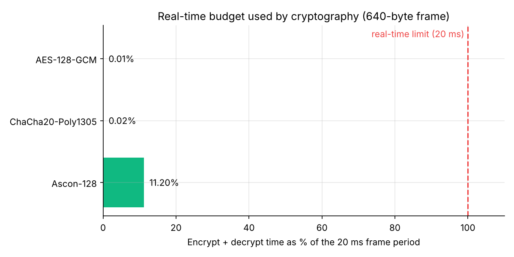 | 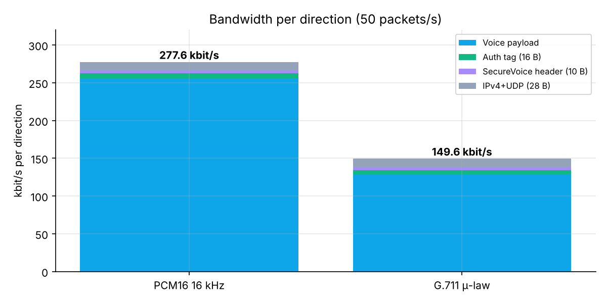 |
|---|---|
| 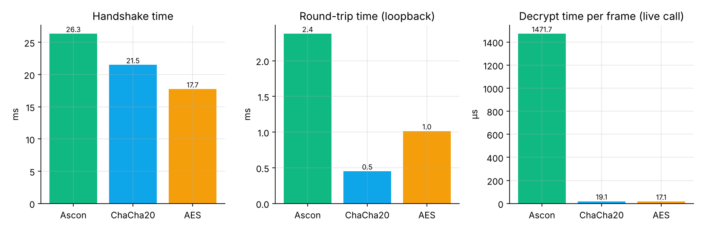 | 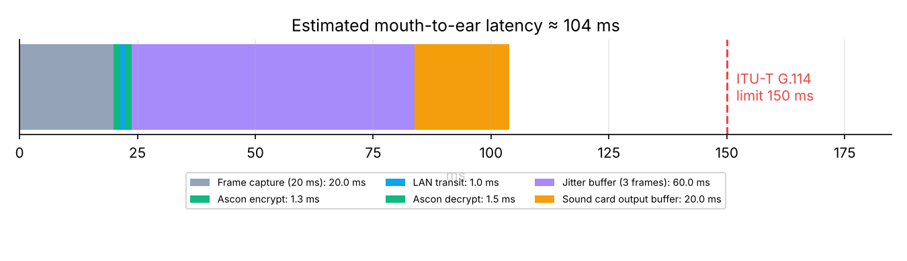 |

### نتائج مكالمات حقيقية لمدة 10 ثوانٍ لكل خوارزمية ([`docs/results/e2e_results.json`](docs/results/e2e_results.json))

| الخوارزمية | الحزم المستلمة | المفقودة | المرفوضة | الإطارات المطابقة بت ببت | زمن المصافحة |
|---|---|---|---|---|---|
| Ascon-128 | ~500 | 0 | 0 | ~500 ✅ | ~24 ms |
| ChaCha20-Poly1305 | ~500 | 0 | 0 | ~500 ✅ | ~18 ms |
| AES-128-GCM | ~500 | 0 | 0 | ~500 ✅ | ~17 ms |

التفاصيل والتحليل: [`docs/08_testing_and_results.md`](docs/08_testing_and_results.md)

---

## ✅ الاختبارات

</div>

```bash
python -m pytest -v
```

<div dir="rtl">

**48 اختباراً — جميعها ناجحة**، وتشمل:
- متجهات الاختبار الرسمية لـ Ascon-128 والمطابقة مع التنفيذ المرجعي.
- رفض أي تعديل في النص المشفر أو الوسم أو الترويسة، والمفتاح أو الـ Nonce الخاطئ.
- المصافحة لكل خوارزمية، وفشلها بكلمة سر خاطئة، ومفاتيح جديدة لكل مكالمة.
- نافذة منع التكرار، والترميز، ومخزن الارتعاش.
- **مكالمات حقيقية عبر الشبكة** بين جلستين: وصول الصوت مطابقاً بت ببت، واكتشاف الهجمات، والرسائل المشفرة، والكتم، ووضع المتنصت.
- اختبار للواجهة الرسومية: نافذتان تُجريان مكالمة.

كما يعمل **GitHub Actions** تلقائياً على Windows و Linux عند كل تحديث، ويبني ملف `SecureVoice.exe`.

---

## 🗂 هيكل المشروع

</div>

```
norhan_graduate_project/
├── main.py                       ← تشغيل البرنامج
├── install.bat / run.bat / firewall.bat / build_exe.bat / run_tests.bat
├── requirements.txt
├── SecureVoice.spec              ← إعدادات بناء الـ exe
├── securevoice/
│   ├── crypto/
│   │   ├── ascon.py              ← ⭐ تنفيذ Ascon-128 من الصفر
│   │   ├── ciphers.py            ← واجهة موحدة لـ Ascon / ChaCha20 / AES-GCM + بناء الـ Nonce
│   │   ├── handshake.py          ← بروتوكول المصافحة X25519 + PBKDF2 + HKDF + Finished
│   │   └── replay.py             ← نافذة منع إعادة الإرسال
│   ├── audio/
│   │   ├── codec.py              ← PCM16 و G.711 μ-law + قياس المستوى
│   │   ├── jitter.py             ← مخزن الارتعاش وإخفاء الفقد
│   │   └── devices.py            ← الميكروفون والسماعة (sounddevice) + نغمة الاختبار
│   ├── net/packet.py             ← بنية حزمة UDP
│   ├── session.py                ← ⭐ محرك المكالمة (القنوات والخيوط والإحصائيات والهجمات)
│   ├── benchmark.py              ← مقارنة الأداء
│   ├── cli.py                    ← تشغيل من سطر الأوامر
│   └── gui/                      ← الواجهة الرسومية (PySide6)
├── tests/                        ← 48 اختباراً آلياً
├── tools/                        ← توليد الصور والرسوم البيانية
├── assets/                       ← أيقونة البرنامج
└── docs/                         ← التوثيق الكامل + المخططات + الصور + النتائج
```

<div dir="rtl">

---

## 📚 التوثيق الكامل

| # | الملف | المحتوى |
|---|---|---|
| 1 | [نظرة عامة على المشروع](docs/01_project_overview.md) | المشكلة، الأهداف، النطاق، المنهجية، الأدوات |
| 2 | [معمارية النظام](docs/02_system_architecture.md) | المكونات، الطبقات، الخيوط، الحالات، تدفق البيانات |
| 3 | [التشفير بالتفصيل](docs/03_cryptography.md) | Ascon-128 خطوة بخطوة، ChaCha20، AES، AEAD، X25519، HKDF، الـ Nonce |
| 4 | [البروتوكول والقناة الناقلة](docs/04_protocol_and_transport.md) | المصافحة بايت ببايت، بنية الحزم، TCP/UDP، رسائل التحكم |
| 5 | [معالجة الصوت](docs/05_audio_pipeline.md) | الالتقاط، الإطارات، الترميز، مخزن الارتعاش، التأخير |
| 6 | [التثبيت والتشغيل على Windows](docs/06_installation_windows.md) | دليل مفصل لجهازين + الشبكة + الجدار الناري + بناء exe |
| 7 | [دليل المستخدم](docs/07_user_guide.md) | شرح كل جزء في الواجهة مع الصور |
| 8 | [الاختبارات والنتائج](docs/08_testing_and_results.md) | الاختبارات، القياسات، الرسوم، التحليل |
| 9 | [التحليل الأمني](docs/09_security_analysis.md) | نموذج التهديد، الهجمات والدفاعات، القيود |
| 10 | [دليل العرض أمام اللجنة](docs/10_committee_demo_guide.md) | سيناريو العرض دقيقة بدقيقة + أسئلة متوقعة وأجوبتها |
| 11 | [شرح الكود ملفاً ملفاً](docs/11_code_walkthrough.md) | شرح كل ملف ودالة مهمة |
| 12 | [هيكل تقرير التخرج والمراجع](docs/12_report_outline.md) | فصول التقرير المقترحة والمراجع العلمية |

---

## 🛠 حل المشاكل الشائعة

| المشكلة | الحل |
|---|---|
| `python` غير معروف | أعد تثبيت Python مع تفعيل **Add to PATH** ثم أعد تشغيل الجهاز |
| «خطأ في الشبكة: timed out / refused» | تأكد أن A ضغط «بدء الاستقبال» أولاً، وأن الـ IP صحيح، وشغّل `firewall.bat` على A |
| «فشلت المصافحة: wrong password» | كلمة السر مختلفة بين الجهازين (حساسة لحالة الأحرف) |
| المكالمة متصلة لكن لا صوت + تحذير «لم تصل أي حزمة صوت» | منفذ UDP محجوب ← شغّل `firewall.bat` على **الجهازين** |
| لا يُسمع الصوت | اختر الميكروفون والسماعة الصحيحين من القائمة، وتحقق من: إعدادات Windows ← الخصوصية ← الميكروفون ← السماح للتطبيقات |
| صدى أو صفير | استخدم سماعات رأس، أو أبعد الجهازين عن بعضهما |
| «المنفذ UDP مستخدم» | البرنامج يختار منفذاً آخر تلقائياً؛ أو غيّر المنفذ يدوياً |
| شبكة الجامعة لا تسمح | استخدم Hotspot الهاتف — الحل الأضمن |

---

<p align="center">
مشروع تخرج — <b>Secure Voice Communication System Based on Lightweight Encryption Algorithms</b><br/>
Python 3 • PySide6 • Ascon-128 • X25519 • HKDF • UDP/TCP
</p>

</div>
