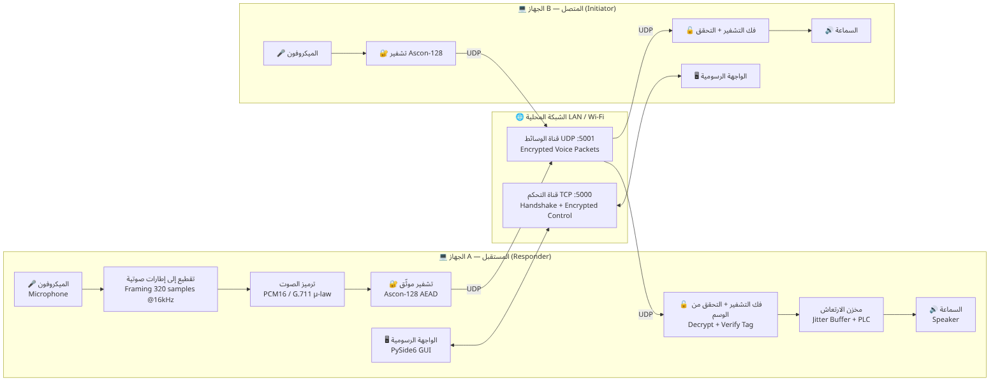
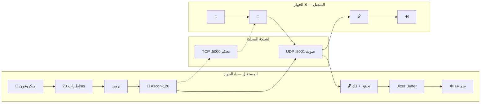
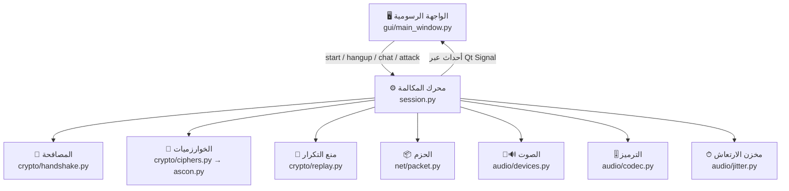
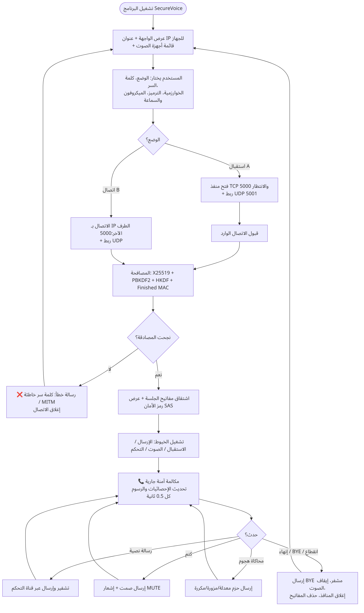
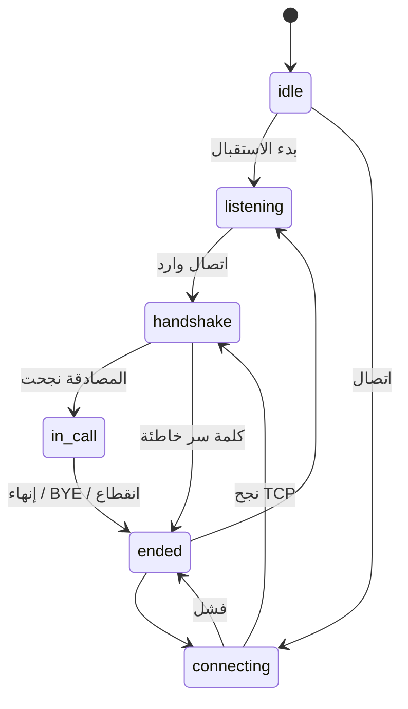
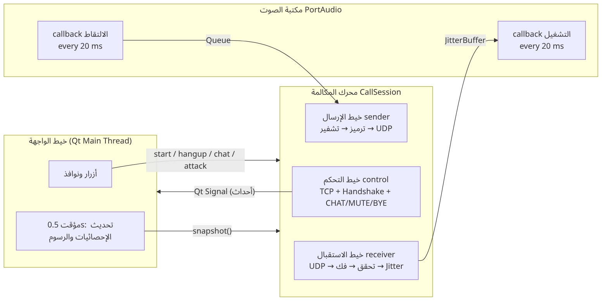

# 2. معمارية النظام

[⬅ العودة للصفحة الرئيسية](../README.md)

## 2.1 الصورة العامة

النظام **نظير لنظير (Peer-to-Peer)**: نفس البرنامج يعمل على الجهازين. أحدهما يأخذ دور **المستقبل (A / Responder)**
الذي ينتظر الاتصال، والآخر دور **المتصل (B / Initiator)**. بعد المصافحة يصبح الطرفان متماثلين تماماً: كل منهما يرسل
صوته ويستقبل صوت الآخر في نفس الوقت (Full-duplex).

## 2.2 الطبقات (Layers)

البرنامج مقسم إلى طبقات مستقلة، كل طبقة لا تعرف تفاصيل الطبقات الأخرى، مما يسهل الاختبار والصيانة:

| الطبقة | المجلد / الملف | المسؤولية |
|---|---|---|
| **الواجهة** Presentation | `securevoice/gui/` | عرض الإعدادات والحالة والإحصائيات، واستقبال أوامر المستخدم |
| **محرك المكالمة** Session | `securevoice/session.py` | إدارة القنوات والخيوط ودورة حياة المكالمة والإحصائيات |
| **التشفير** Crypto | `securevoice/crypto/` | Ascon-128، واجهة AEAD، المصافحة، نافذة منع التكرار |
| **الشبكة** Network | `securevoice/net/packet.py` + sockets | بنية الحزم، TCP، UDP |
| **الصوت** Audio | `securevoice/audio/` | الالتقاط والتشغيل، الترميز، مخزن الارتعاش |

## 2.3 مخطط سير البرنامج (Program Flowchart)

## 2.4 حالات المكالمة (State Machine)

| الحالة | المعنى | ما يظهر في الواجهة |
|---|---|---|
| `idle` | لا يوجد اتصال | ● غير متصل |
| `listening` | الجهاز A ينتظر على TCP 5000 | ● بانتظار مكالمة واردة... |
| `connecting` | الجهاز B يحاول الاتصال | ● جاري الاتصال... |
| `handshake` | تبادل المفاتيح والمصادقة | ● تبادل المفاتيح والمصادقة... |
| `in_call` | مكالمة آمنة جارية | ● مكالمة آمنة جارية 🔒 |
| `ended` | انتهت (إنهاء / خطأ / كلمة سر خاطئة) | ● انتهت المكالمة |

## 2.5 الخيوط (Threads) والتزامن

الصوت الآني يتطلب ألا يتوقف أي جزء بسبب جزء آخر. لذلك يعمل البرنامج بعدة خيوط متوازية:

| الخيط | يعمل في | الوظيفة | التواصل |
|---|---|---|---|
| **Qt Main** | الواجهة | الأزرار، ومؤقت كل 0.5 ثانية لتحديث الإحصائيات والرسوم | يقرأ `session.snapshot()` |
| **control** | المحرك | الاتصال TCP + المصافحة، ثم استقبال رسائل التحكم المشفرة | يرسل الأحداث بـ Qt Signal |
| **sender** | المحرك | يسحب الإطارات من الطابور ← ترميز ← تشفير ← UDP، و PING كل ثانية | `queue.Queue` من الالتقاط |
| **receiver** | المحرك | UDP ← فحص التكرار ← تحقق وفك ← مخزن الارتعاش | يكتب في `JitterBuffer` |
| **capture callback** | PortAudio | يُستدعى كل 20ms بإطار جديد من الميكروفون (يضعه في الطابور فقط) | `Queue.put_nowait` |
| **playback callback** | PortAudio | يُستدعى كل 20ms يطلب إطاراً للسماعة | `JitterBuffer.pop` |

> **قاعدة تصميم مهمة:** دوال الـ callback الخاصة بكرت الصوت يجب أن تكون سريعة جداً، لذلك لا يحدث فيها تشفير؛
> التشفير وفك التشفير في خيطَي sender و receiver. أحداث المحرك تنتقل للواجهة عبر **Qt Signal** (آمنة بين الخيوط).

## 2.6 تدفق البيانات في مكالمة كاملة

1. المستخدم يضغط «بدء» ← `MainWindow._start()` ينشئ `CallSession` ويستدعي `start_listen()` أو `start_call(ip)`.
2. خيط control: ربط UDP ← TCP (accept/connect) ← `server_handshake()` / `client_handshake()` ← `SessionKeys`.
3. `_start_media()`: إنشاء كائنات التشفير (4 مفاتيح)، والترميز، ونافذة التكرار، ومخزن الارتعاش، وتشغيل sender و receiver وكرت الصوت.
4. حدث `connected` ← الواجهة تعرض رمز الأمان والخوارزمية والبصمة.
5. أثناء المكالمة: 50 حزمة/ثانية في كل اتجاه + PING كل ثانية + رسائل تحكم عند الطلب.
6. الإنهاء: `hangup()` ← إرسال BYE مشفر ← `_shutdown()` يوقف الصوت ويغلق المنافذ ← حدث `ended`.

## 2.7 لماذا Python؟

- سهولة القراءة والشرح أمام اللجنة: تنفيذ Ascon كاملاً في ≈ 150 سطراً واضحاً.
- مكتبات ناضجة للصوت (PortAudio) والتشفير (OpenSSL عبر `cryptography`) والواجهة (Qt).
- متعددة المنصات، ويمكن تحويلها إلى `.exe` مستقل.
- الأداء كافٍ: حتى Ascon بلغة Python خالصة يستهلك ≈ 11% فقط من زمن الإطار.

