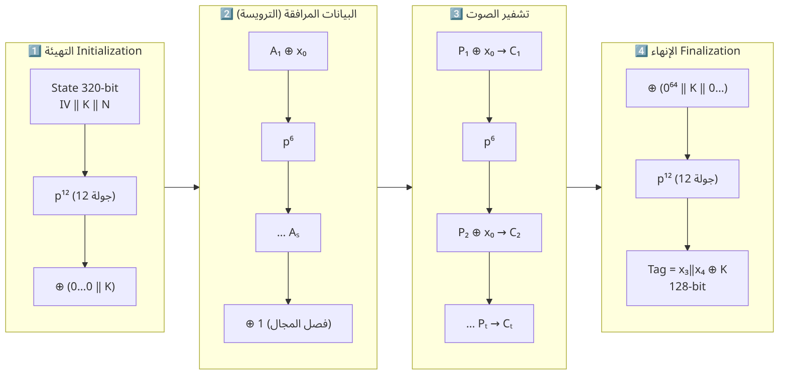
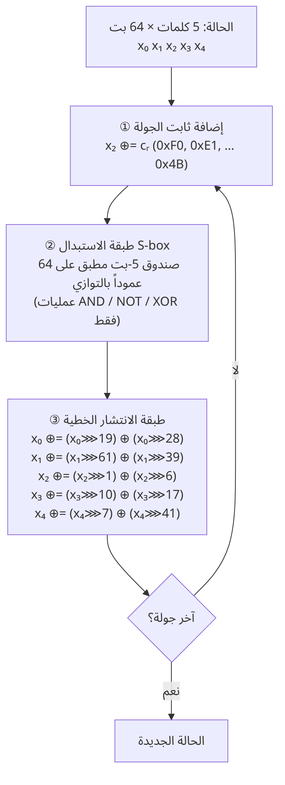
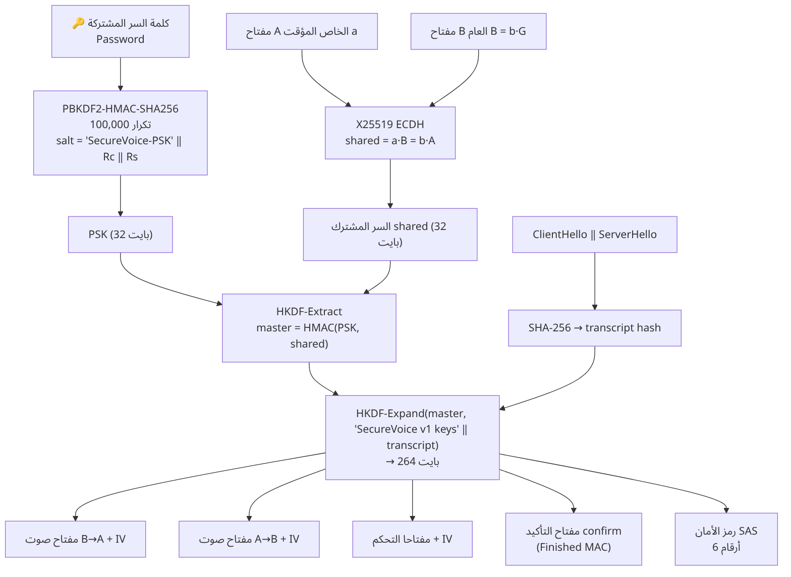

<div dir="rtl">

# 3. التشفير بالتفصيل

[⬅ العودة للصفحة الرئيسية](../README.md)

## 3.1 مفاهيم أساسية

| المفهوم | الشرح |
|---|---|
| **التشفير المتماثل** Symmetric | نفس المفتاح للتشفير وفك التشفير. سريع جداً ← مناسب للصوت. المشكلة: كيف يتفق الطرفان على المفتاح؟ ← تبادل المفاتيح (3.6) |
| **التشفير غير المتماثل** Asymmetric | مفتاح عام ومفتاح خاص. بطيء نسبياً ← نستخدمه مرة واحدة في بداية المكالمة لتبادل المفاتيح (X25519) |
| **AEAD** | Authenticated Encryption with Associated Data: تشفير + وسم مصادقة في عملية واحدة. يضمن السرية والسلامة والأصالة |
| **AD** Associated Data | بيانات **لا تُشفّر لكنها تُوثّق**، مثل ترويسة الحزمة: يقرؤها الجميع لكن أي تعديل عليها يُكتشف |
| **Nonce** | Number used ONCE: قيمة يجب ألا تتكرر أبداً مع نفس المفتاح. تكرارها يكسر الأمان كلياً |
| **Tag** الوسم | 128 بت تُلحق بالنص المشفر. يحسبها المستقبل من جديد؛ إن اختلفت ← الحزمة مرفوضة |
| **Forward Secrecy** | لو سُرق مفتاح طويل الأمد لاحقاً لا يمكن فك المكالمات السابقة، لأن مفاتيح كل مكالمة مؤقتة وحُذفت |

## 3.2 لماذا التشفير خفيف الوزن؟

خوارزمية AES ممتازة وسريعة جداً **عندما** يحتوي المعالج على تعليمات خاصة بها (AES-NI). لكن في:
- المتحكمات الدقيقة (ARM Cortex-M، AVR)، وأجهزة إنترنت الأشياء، وأجهزة الاتصال المحمولة،
- والدوائر المتكاملة الصغيرة (RFID، البطاقات الذكية)،

تكون AES المنفّذة برمجياً **بطيئة** وتستخدم **جداول بحث (S-box tables)** معرضة لـ**هجمات التوقيت والذاكرة المؤقتة (cache-timing)**،
وتحتاج مساحة عتادية وطاقة أكبر.

لذلك أطلقت **NIST** عام 2018 مسابقة **Lightweight Cryptography** شارك فيها 57 تصميماً، وبعد 4 سنوات أُعلن فوز
**Ascon** في فبراير 2023، ثم صدر المعيار **NIST SP 800-232** في 2025.

| الخاصية | Ascon-128 | AES-128-GCM | ChaCha20-Poly1305 |
|---|---|---|---|
| النوع | Sponge (إسفنجي) + تبديل | Block cipher + GHASH | Stream cipher ARX + Poly1305 |
| حجم الحالة | **320 بت** | 128 بت + جدول مفاتيح 1408 بت | 512 بت |
| العمليات | AND, NOT, XOR, ROT فقط | S-box (جداول)، ضرب في GF(2¹²⁸) | ADD, ROT, XOR + ضرب modular |
| مقاومة هجمات التوقيت | ✅ طبيعياً (bitsliced) | ⚠️ برمجياً بدون AES-NI | ✅ |
| تسريع عتادي مطلوب؟ | ❌ لا | ✅ AES-NI + PCLMULQDQ للأداء | ❌ لا |
| الملاءمة للعتاد الصغير | ⭐⭐⭐ ممتازة | ⭐⭐ | ⭐ (حالة كبيرة) |
| التشفير وفك التشفير | نفس التبديل (لا حاجة لدالة عكسية) | يحتاج AES فقط في وضع CTR | نفس الدالة |
| المعيار | NIST SP 800-232، CAESAR | FIPS 197 + SP 800-38D | RFC 8439 |
| المفتاح / Nonce / Tag | 128 / 128 / 128 | 128 / 96 / 128 | 256 / 96 / 128 |

## 3.3 خوارزمية Ascon-128 خطوة بخطوة

> التنفيذ الكامل في [`securevoice/crypto/ascon.py`](../securevoice/crypto/ascon.py) — مكتوب من الصفر ومُتحقق منه
> بمتجهات الاختبار الرسمية (`E355159F292911F794CB1432A0103A8A` لمفتاح و Nonce = 00..0F مع نص فارغ).

> **ملاحظة دقيقة عن الإصدار:** المنفّذ هنا هو **Ascon-128 v1.2** — الإصدار الذي فاز بمسابقة NIST LWC وفي محفظة CAESAR وله
> متجهات اختبار رسمية منشورة. المعيار النهائي **NIST SP 800-232** سمّاه **Ascon-AEAD128** وأجرى عليه تعديلات طفيفة
> (ترتيب البايتات little-endian، ومعدل 128 بت بدلاً من 64، وقيمة IV مختلفة) مع **نفس دالة التبديل ونفس البنية الأمنية**.
> الانتقال إلى الإصدار المعياري تعديل بسيط في `ascon.py` ويُذكر كعمل مستقبلي.

### المعاملات

| المعامل | القيمة |
|---|---|
| المفتاح K | 128 بت |
| الـ Nonce N | 128 بت |
| الوسم T | 128 بت |
| الحالة S | 320 بت = 5 كلمات × 64 بت: `x0, x1, x2, x3, x4` |
| المعدل r (Rate) | 64 بت = 8 بايت تُعالج في كل كتلة |
| جولات التهيئة/الإنهاء a | 12 |
| جولات معالجة البيانات b | 6 |
| IV | `0x80400C0600000000` (يرمّز k=128, r=64, a=12, b=6) |

### البنية العامة: Duplex Sponge



**① التهيئة (Initialization)**

</div>

```
S = IV ‖ K ‖ N                      # 64 + 128 + 128 = 320 بت
S = p¹²(S)                          # 12 جولة تبديل
S = S ⊕ (0^192 ‖ K)                 # مزج المفتاح مرة أخرى
```

<div dir="rtl">

**② معالجة البيانات المرافقة AD (ترويسة الحزمة 10 بايت)**

</div>

```
إذا كانت AD غير فارغة:
   حشو AD: إضافة البايت 0x80 ثم أصفار حتى يصبح الطول من مضاعفات 8
   لكل كتلة Aᵢ (8 بايت):   x0 = x0 ⊕ Aᵢ ;  S = p⁶(S)
x4 = x4 ⊕ 1                          # فصل المجال: يمنع الخلط بين AD والنص
```

<div dir="rtl">

**③ تشفير النص (الصوت)**

</div>

```
حشو P بنفس الطريقة
لكل كتلة Pᵢ ما عدا الأخيرة:  x0 = x0 ⊕ Pᵢ ;  Cᵢ = x0 ;  S = p⁶(S)
الكتلة الأخيرة:              x0 = x0 ⊕ Pₜ ;  Cₜ = أول |Pₜ| بايت من x0
```

<div dir="rtl">

**④ الإنهاء وتوليد الوسم**

</div>

```
x1 = x1 ⊕ K[0:8] ;  x2 = x2 ⊕ K[8:16]
S = p¹²(S)
T = (x3 ⊕ K[0:8]) ‖ (x4 ⊕ K[8:16])        # 128 بت
الناتج = C ‖ T
```

<div dir="rtl">

**فك التشفير:** نفس الخطوات، لكن في كل كتلة `Pᵢ = x0 ⊕ Cᵢ` ثم `x0 = Cᵢ`. في النهاية يُحسب الوسم ويُقارن
**بزمن ثابت** (constant-time) مع الوسم المستلم؛ إذا اختلف بت واحد ← `AsconAuthError` ولا يُعاد أي نص.

### دالة التبديل p (الجولة الواحدة)



كل جولة 3 خطوات:

1. **إضافة الثابت:** `x2 ^= c` حيث الثوابت `F0, E1, D2, C3, B4, A5, 96, 87, 78, 69, 5A, 4B` (التبديل p⁶ يستخدم آخر 6).
2. **طبقة الاستبدال (S-box 5-bit):** تُطبّق على 64 عموداً بالتوازي (bitsliced) باستخدام AND/NOT/XOR فقط —
   لا جداول بحث ← لا تسريب عبر الذاكرة المؤقتة:

</div>

```python
x0 ^= x4; x4 ^= x3; x2 ^= x1
t0 = ~x0 & x1; t1 = ~x1 & x2; t2 = ~x2 & x3; t3 = ~x3 & x4; t4 = ~x4 & x0
x0 ^= t1; x1 ^= t2; x2 ^= t3; x3 ^= t4; x4 ^= t0
x1 ^= x0; x0 ^= x4; x3 ^= x2; x2 = ~x2
```

<div dir="rtl">

3. **طبقة الانتشار الخطية:** كل كلمة تُمزج مع نسختين مدوّرتين منها، لنشر تأثير كل بت على كامل الكلمة:

</div>

```python
x0 ^= rotr(x0, 19) ^ rotr(x0, 28)
x1 ^= rotr(x1, 61) ^ rotr(x1, 39)
x2 ^= rotr(x2,  1) ^ rotr(x2,  6)
x3 ^= rotr(x3, 10) ^ rotr(x3, 17)
x4 ^= rotr(x4,  7) ^ rotr(x4, 41)
```

<div dir="rtl">

### لماذا Ascon آمن؟
- **أمان 128 بت** ضد استعادة المفتاح، وأفضل الهجمات المنشورة لا تكسر أكثر من 7 جولات من أصل 12 في التهيئة.
- **المفتاح يُمزج في التهيئة والإنهاء** ← حتى لو استُرجعت الحالة الداخلية أثناء معالجة البيانات لا يُسترجع المفتاح مباشرة.
- **تأثير الانهيار (Avalanche):** تغيير بت واحد في الصوت يغيّر الوسم بالكامل (اختبار `test_tamper_ciphertext_rejected`).

## 3.4 الخوارزميتان الأخريان (للمقارنة)

**ChaCha20-Poly1305 (RFC 8439):** تشفير تيار من عائلة ARX (Add-Rotate-XOR) صممه D. J. Bernstein، تستخدمه
TLS 1.3 و WireGuard و Signal كبديل لـ AES على الهواتف. حالته 512 بت (أكبر من Ascon).

**AES-128-GCM:** المعيار التقليدي. AES في وضع العداد CTR للتشفير + GHASH للمصادقة. الأسرع على الحواسيب الحديثة
بفضل تعليمات AES-NI، ولذلك نستخدمه **كمرجع للمقارنة**.

## 3.5 بناء الـ Nonce (حرج جداً)

إعادة استخدام Nonce مع نفس المفتاح **كارثة**: في الخوارزميات التيارية تسمح بحساب `P1 ⊕ P2` واسترجاع الصوت، وفي GCM تكشف مفتاح المصادقة.

الحل المستخدم (نفس أسلوب **TLS 1.3**):

</div>

```
Nonce = IV_direction  XOR  sequence_number
```

<div dir="rtl">

- `IV_direction`: قيمة سرية 16 بايت مشتقة من المصافحة، **مختلفة لكل اتجاه** ولكل مكالمة، ولا تُرسل على الشبكة.
- `sequence_number`: عداد يبدأ من 1 ويزيد مع **كل** حزمة (صوت أو PING أو PONG)، ولا يتكرر أبداً.
- إذا اقترب العداد من 2³² (بعد ≈ 2.7 سنة من المكالمة المستمرة) يرفض البرنامج الإرسال بدلاً من تكرار الـ Nonce.
- **مفتاح مختلف لكل اتجاه** (`K_c2s` و `K_s2c`) ← حتى لو تساوى رقم التسلسل في الاتجاهين لا يتكرر زوج (مفتاح، Nonce)،
  كما يمنع ذلك **هجوم الانعكاس (Reflection)**: إعادة حزمة A إليه نفسه تفشل لأن مفتاح استقباله مختلف.

## 3.6 تبادل المفاتيح X25519 (Diffie-Hellman على المنحنى الإهليلجي)

- كل طرف يولّد **مفتاحاً خاصاً عشوائياً مؤقتاً** `a` (32 بايت) ويحسب العام `A = a·G` على المنحنى Curve25519.
- يتبادلان المفاتيح العامة فقط.
- A يحسب `a·B` و B يحسب `b·A` ← **نفس النتيجة** `a·b·G` = السر المشترك.
- المتنصت يرى `A` و `B` فقط، واستخراج `a` منهما هو مسألة اللوغاريتم المتقطع (≈ 2¹²⁸ عملية).
- المفاتيح الخاصة تُولّد لكل مكالمة وتُنسى بعدها ← **سرية أمامية**.

**لماذا لا يكفي X25519 وحده؟** لأنه غير موثّق: مهاجم في المنتصف يمكنه إجراء تبادل منفصل مع كل طرف.
الحل: **ربط كلمة السر المشتركة** في اشتقاق المفاتيح + **Finished MAC** + **رمز الأمان SAS**.

## 3.7 اشتقاق المفاتيح (Key Schedule)



</div>

```
PSK        = PBKDF2-HMAC-SHA256(password, salt = "SecureVoice-PSK" ‖ Rc ‖ Rs, iterations = 100000, 32 bytes)
shared     = X25519(my_private, peer_public)
transcript = SHA-256(ClientHello ‖ ServerHello)
master     = HKDF-Extract(salt = PSK, ikm = shared)            = HMAC-SHA256(PSK, shared)
OKM (264B) = HKDF-Expand(master, info = "SecureVoice v1 keys" ‖ transcript)
```

<div dir="rtl">

| الجزء من OKM | الحجم | الاستخدام |
|---|---|---|
| `c2s_key` | 32 | مفتاح صوت B ← A (يُقتطع إلى 16 بايت لـ Ascon و AES) |
| `s2c_key` | 32 | مفتاح صوت A ← B |
| `ctl_c2s_key` / `ctl_s2c_key` | 32 + 32 | مفاتيح رسائل التحكم |
| `c2s_iv` / `s2c_iv` | 16 + 16 | IV لبناء الـ Nonce للصوت |
| `ctl_c2s_iv` / `ctl_s2c_iv` | 16 + 16 | IV للتحكم |
| `confirm` | 32 | مفتاح Finished MAC |
| `sas` | 8 | رمز الأمان (6 أرقام = القيمة mod 10⁶) |

**لماذا PBKDF2 بـ 100,000 تكرار؟** لإبطاء تخمين كلمة السر: كل محاولة تكلف المهاجم 100,000 عملية HMAC.

**لماذا الـ transcript في الاشتقاق؟** يربط المفاتيح بكل رسائل المصافحة؛ أي تعديل في ClientHello (مثلاً خفض الخوارزمية
Downgrade) يغيّر كل المفاتيح فيفشل Finished.

## 3.8 التحقق النهائي (Finished)

</div>

```
Client → Server :  HMAC-SHA256(confirm, "client finished" ‖ transcript)
Server → Client :  HMAC-SHA256(confirm, "server finished" ‖ transcript)
```

<div dir="rtl">

يتحقق كل طرف بمقارنة زمن ثابت (`hmac.compare_digest`). النجاح يثبت أن الطرف الآخر: (1) يعرف كلمة السر،
(2) حسب نفس السر المشترك، (3) رأى نفس رسائل المصافحة. وإلا: «wrong password or MITM attack» ولا يبدأ أي صوت.

## 3.9 نافذة منع إعادة الإرسال

مأخوذة من IPsec (RFC 4303) و DTLS: تحفظ أعلى رقم تسلسل مستلم `highest` وخريطة بتات من 64 بت:

- `seq > highest` ← جديدة ✅ (تُزاح النافذة).
- `highest - seq ≥ 64` ← قديمة جداً ⛔.
- البت المقابل = 1 ← مكررة ⛔.
- وإلا ← جديدة وصلت متأخرة (إعادة ترتيب UDP) ✅.

الفحص يتم **قبل** فك التشفير (توفير المعالجة)، والتحديث **بعد** نجاح التحقق من الوسم فقط (حتى لا يتمكن مهاجم من
"حجز" أرقام تسلسل بحزم مزوّرة).

</div>
