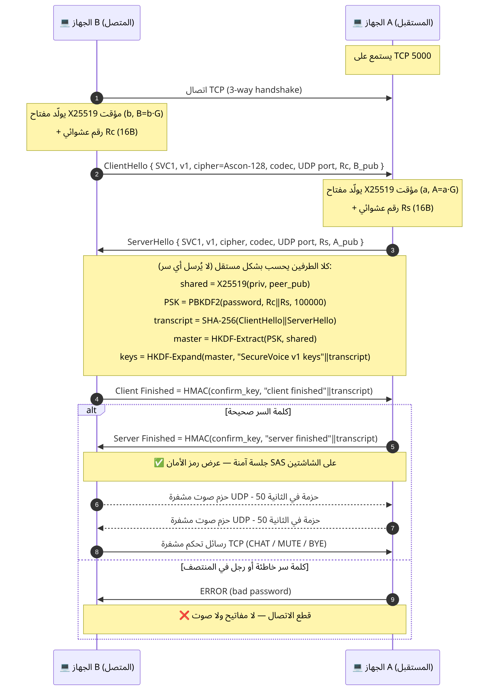
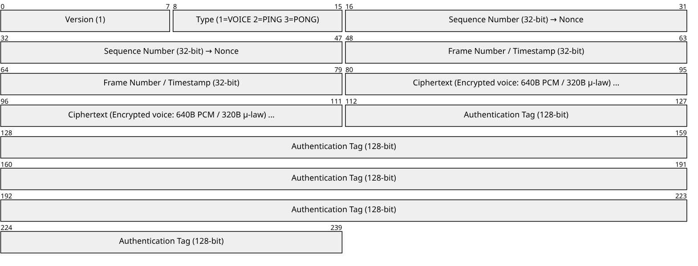
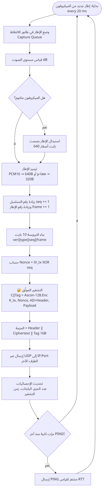
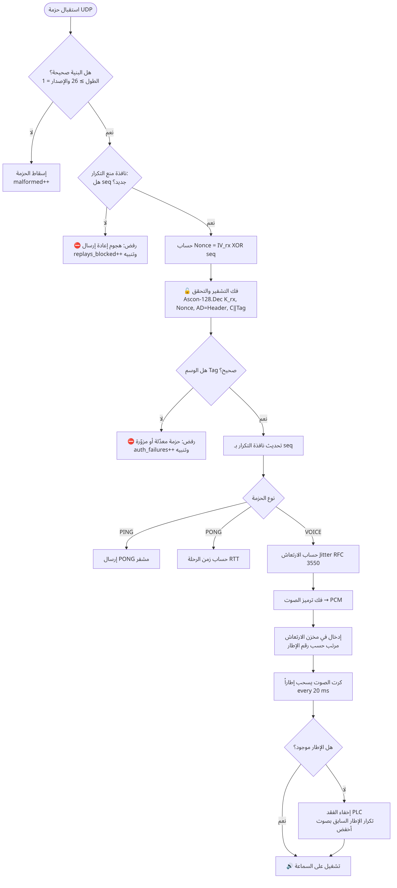

<div dir="rtl">

# 4. البروتوكول والقناة الناقلة بين الجهازين

[⬅ العودة للصفحة الرئيسية](../README.md)

## 4.1 القناتان

| | قناة التحكم | قناة الوسائط |
|---|---|---|
| البروتوكول | **TCP** | **UDP** |
| المنفذ الافتراضي | 5000 (على الجهاز A) | 5001 على كل جهاز (يمكن تغييره؛ وعند التجربة على جهاز واحد 5002 للثاني) |
| ما ينتقل | المصافحة، ثم رسائل مشفرة: CHAT، MUTE، BYE | حزم الصوت المشفرة + PING/PONG مشفرة |
| المعدل | نادر (عند الحاجة) | 50 حزمة صوت/ثانية لكل اتجاه + 1 PING/ثانية |
| من يفتح الاتصال | B يتصل بـ A | كل طرف يرسل إلى `IP الطرف الآخر : منفذ UDP الذي أعلنه في المصافحة` |

### لماذا UDP للصوت وليس TCP؟
- TCP يعيد إرسال أي حزمة مفقودة وينتظرها قبل تسليم ما بعدها (Head-of-line blocking) ← تأخير متراكم وتقطّع.
- في الصوت الحي، **الحزمة المتأخرة لا قيمة لها**: الأفضل إسقاطها وإخفاء الفقد (PLC) ثم المتابعة.
- لهذا تستخدم كل أنظمة VoIP (SIP/RTP، WhatsApp، Zoom، Teams) بروتوكول UDP للوسائط.

### لماذا TCP للتحكم؟
- المصافحة ورسالة إنهاء المكالمة يجب أن تصل **بالتأكيد وبالترتيب**.
- انقطاع اتصال TCP يعني أن الطرف الآخر أغلق البرنامج ← إنهاء المكالمة تلقائياً.

## 4.2 المصافحة بايت ببايت



كل رسالة على TCP تُرسل بإطار: `[طول 2 بايت big-endian] ‖ [البيانات]`.

### ClientHello / ServerHello (57 بايت)

| الإزاحة | الحقل | الحجم | القيمة |
|---|---|---|---|
| 0 | Magic | 4 | `SVC1` (للتأكد أن الطرف الآخر هو برنامجنا) |
| 4 | Version | 1 | 1 |
| 5 | Cipher ID | 1 | 1 = Ascon-128، 2 = ChaCha20-Poly1305، 3 = AES-128-GCM |
| 6 | Codec ID | 1 | 1 = PCM16، 2 = G.711 μ-law |
| 7 | UDP Port | 2 | المنفذ الذي يستقبل عليه هذا الطرف الصوت |
| 9 | Random | 16 | رقم عشوائي (Rc أو Rs) لملح PBKDF2 |
| 25 | X25519 Public Key | 32 | المفتاح العام المؤقت |

- الخوارزمية والترميز **يختارهما المتصل B**، والمستقبل A يقبلهما ويعيدهما كما هي في ServerHello.
- إذا أعاد A قيماً مختلفة يرفض B المصافحة («downgrade attempt?»).

### Finished (32 بايت لكل اتجاه)
`HMAC-SHA256(confirm_key, label ‖ transcript_hash)`. إذا فشل تحقق A من رسالة B يرسل بايتاً واحداً `0x01` (ERR_BAD_PASSWORD) ويغلق.

### الزمن
المصافحة كاملة ≈ **20–50ms** على الشبكة المحلية، معظمها في PBKDF2 (100,000 تكرار).

## 4.3 حزمة الصوت على UDP

</div>

```
 0        1        2                 6                 10                         N-16      N
 +--------+--------+-----------------+-----------------+---------------------------+---------+
 |version |  type  |  sequence (u32) |  frame # (u32)  |  ciphertext (encrypted)   | tag 16B |
 +--------+--------+-----------------+-----------------+---------------------------+---------+
 |<------------- header 10 bytes: Associated Data (موثّق، غير مشفّر) -------------->|
```



<div dir="rtl">

| الحقل | الشرح |
|---|---|
| version | 1. أي قيمة أخرى ← إسقاط |
| type | 1 VOICE، 2 PING، 3 PONG |
| sequence | عداد الحزم في هذا الاتجاه — يُبنى منه الـ Nonce، وتفحصه نافذة منع التكرار |
| frame # | في VOICE: رقم الإطار الصوتي (يرتّب به مخزن الارتعاش ويحسب الارتعاش). في PING/PONG: زمن بالمللي ثانية |
| ciphertext | الصوت المشفر: 640 بايت (PCM16) أو 320 (μ-law). في PING/PONG: 8 بايت (زمن الإرسال) |
| tag | وسم المصادقة 128 بت يغطي الترويسة + الصوت |

**حجم الحزمة:** 10 + 640 + 16 = **666 بايت** (PCM16)، أو 346 بايت (μ-law). مع ترويسة IP/UDP (28 بايت):
- PCM16: 694 × 8 × 50 = **277.6 kbit/s** لكل اتجاه.
- μ-law: 374 × 8 × 50 = **149.6 kbit/s** لكل اتجاه.

كلاهما صغير جداً بالنسبة لشبكة Wi-Fi (عشرات إلى مئات Mbit/s).

### مثال حقيقي من فاحص الحزم في البرنامج

</div>

```
TX  seq=610  VOICE  666 B
    plain  : 00 00 5f 05 95 0a 7b 0f eb 13 c3 17 ...   ← عينات الصوت الأصلية
    nonce  : f01c2c350b8f2d7063251... (= IV ⊕ 610)
    cipher : d7 da e8 7f 91 f1 65 c1 80 1d ...          ← ما يراه Wireshark
    tag    : 7b3e...  (16 بايت)
    status : OK
RX  seq=399  VOICE  666 B   status: AUTH FAIL          ← حزمة معدّلة (محاكاة هجوم)
RX  seq=1    VOICE  666 B   status: REPLAY             ← حزمة قديمة أعيد إرسالها
```

<div dir="rtl">

## 4.4 خوارزمية الإرسال



الكود: `CallSession._sender_loop()` في [`session.py`](../securevoice/session.py).

## 4.5 خوارزمية الاستقبال



الكود: `CallSession._receiver_loop()`. **الترتيب مهم:** فحص البنية ← فحص التكرار (رخيص) ← فك التشفير والتحقق (مكلف)
← تحديث النافذة (فقط بعد النجاح).

## 4.6 قياس زمن الرحلة RTT

كل ثانية يرسل كل طرف حزمة **PING** مشفرة تحتوي زمن الإرسال (8 بايت). الطرف الآخر يفك تشفيرها ويرد بـ **PONG**
مشفرة بنفس المحتوى. عند وصولها: `RTT = الآن − زمن الإرسال`، مع متوسط متحرك أُسّي (0.8 قديم + 0.2 جديد).

## 4.7 قياس الارتعاش (Jitter) — RFC 3550

لكل حزمتين متتاليتين: `D = (وصول₂ − وصول₁) − (إطار₂ − إطار₁) × 20ms`، ثم `J = J + (|D| − J) / 16`.
هذا نفس تعريف RTP المستخدم في أنظمة VoIP.

## 4.8 رسائل التحكم المشفرة (TCP)

</div>

```
Frame = [ctl_seq 8B] ‖ AEAD.Encrypt(K_ctl, Nonce = IV_ctl ⊕ ctl_seq, AD = "CTL" ‖ ctl_seq, [type 1B] ‖ body)
```

<div dir="rtl">

| النوع | القيمة | المحتوى |
|---|---|---|
| CHAT | 1 | نص UTF-8 (رسالة الدردشة) |
| BYE | 2 | فارغ — إنهاء المكالمة |
| MUTE | 3 | `0x01` كتم / `0x00` إلغاء الكتم |

رقم التسلسل يجب أن يكون أكبر من آخر رقم مستلم، وإلا تُرفض الرسالة (منع التكرار). الرسائل تستخدم مفاتيح منفصلة عن الصوت.

## 4.9 ماذا يحدث عند المشاكل؟

| الحالة | السلوك |
|---|---|
| حزمة صوت مفقودة | مخزن الارتعاش يخفي الفقد بتكرار الإطار السابق بنصف الصوت |
| حزم بترتيب مختلف | تُرتّب حسب رقم الإطار |
| تأخر متراكم (ساعتا كرتي الصوت مختلفتان) | يُسقط إطار قديم عندما يتجاوز المخزن 7 إطارات |
| لا حزم UDP لمدة 4 ثوانٍ | تحذير في السجل: «تحقق من الجدار الناري (منفذ UDP)» |
| انقطاع TCP | إنهاء المكالمة: «انقطع الاتصال بالطرف الآخر» |
| المنفذ UDP مستخدم | يُختار منفذ تلقائي ويُعلن في المصافحة |

</div>
