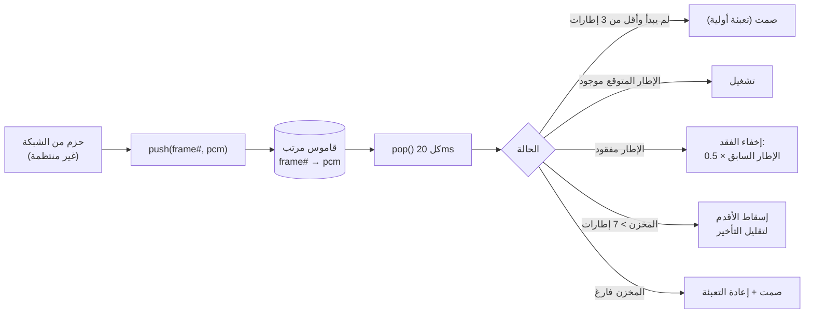
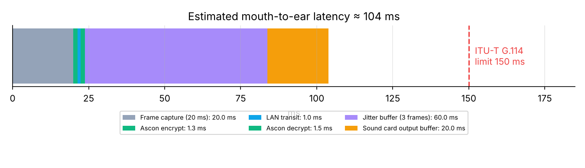

<div dir="rtl">

# 5. معالجة الصوت (Audio Pipeline)

[⬅ العودة للصفحة الرئيسية](../README.md)

## 5.1 من الصوت التماثلي إلى البايتات

| المعامل | القيمة | السبب |
|---|---|---|
| معدل العينات | **16,000 عينة/ثانية** (16 kHz) | صوت عريض النطاق Wideband (حتى 8 kHz) — أوضح من الهاتف التقليدي (8 kHz) |
| دقة العينة | **16 بت** (int16) | مدى ديناميكي ≈ 96 dB |
| القنوات | **1** (Mono) | الكلام لا يحتاج ستيريو |
| طول الإطار | **20 ms = 320 عينة = 640 بايت** | المعيار في VoIP: توازن بين التأخير وعدد الحزم |
| معدل الحزم | **50 حزمة/ثانية** لكل اتجاه | 1000ms ÷ 20ms |

مكتبة **sounddevice** (غلاف لـ **PortAudio**) تفتح:
- `RawInputStream` للميكروفون: تستدعي دالة callback كل 20ms بإطار 640 بايت.
- `RawOutputStream` للسماعة: تستدعي دالة callback كل 20ms تطلب 640 بايت للتشغيل.

على Windows تُستخدم واجهة **MME** الافتراضية التي تقبل 16 kHz وتحوّل المعدل تلقائياً إن كان كرت الصوت يعمل على 44.1/48 kHz.

## 5.2 الترميز (Codec)

### PCM 16-bit (الافتراضي)
الصوت الخام بدون ضغط ← **جودة كاملة**، 640 بايت/إطار، 256 kbit/s.

### G.711 μ-law (اختياري)
معيار ITU-T G.711 المستخدم في شبكات الهاتف منذ 1972. يضغط كل عينة من 16 بت إلى **8 بت** بمنحنى لوغاريتمي
(دقة أعلى للأصوات الهادئة حيث الأذن أكثر حساسية):

</div>

```
mag      = min(|x|, 32635) + 132
exponent = floor(log2(mag)) − 7          (0..7)
mantissa = (mag >> (exponent + 3)) & 0x0F
μ        = NOT(sign<<7 | exponent<<4 | mantissa)
```

<div dir="rtl">

- 320 بايت/إطار ← **نصف عرض النطاق** (128 kbit/s).
- نسبة الإشارة للضجيج في الاختبار > 30 dB (اختبار `test_ulaw_codec_halves_size_and_low_error`).
- التنفيذ بجداول NumPy محسوبة مسبقاً (65,536 قيمة للترميز و 256 لفك الترميز) ← سريع جداً.

## 5.3 مخزن الارتعاش (Jitter Buffer)

الحزم عبر UDP لا تصل بانتظام مثالي: بعضها يتأخر، وبعضها يصل بترتيب مختلف، وقد يضيع بعضها.
كرت الصوت في المقابل يطلب إطاراً **بالضبط كل 20ms**. مخزن الارتعاش يحل هذا التعارض:

</div>



<div dir="rtl">

| الآلية | التفاصيل |
|---|---|
| **إعادة الترتيب** | الإطارات تُخزّن بقاموس مفتاحه رقم الإطار، وتُسحب بالترتيب |
| **التعبئة الأولية** | ينتظر 3 إطارات (60ms) قبل بدء التشغيل لامتصاص تذبذب الشبكة |
| **إخفاء الفقد PLC** | إطار مفقود ← تكرار السابق بنصف الشدة (وتتناقص مع الفقد المتتالي) بدل صمت مفاجئ |
| **الحزم المتأخرة** | إطار وصل بعد موعد تشغيله ← يُهمل ويُحسب «late» |
| **التحكم بالتأخير** | ساعتا كرتي الصوت في الجهازين لا تتطابقان تماماً؛ إذا تراكمت أكثر من 7 إطارات يُسقط الأقدم |

## 5.4 ميزانية التأخير (من الفم إلى الأذن)



| المرحلة | الزمن التقريبي |
|---|---|
| تجميع إطار من الميكروفون | 20 ms |
| تشفير Ascon-128 | ≈ 1.3 ms |
| النقل عبر الشبكة المحلية | ≈ 1 ms |
| فك التشفير | ≈ 1.4 ms |
| مخزن الارتعاش (3 إطارات) | 60 ms |
| مخزن السماعة | ≈ 20 ms |
| **المجموع** | **≈ 104 ms** < 150 ms (توصية ITU-T G.114) ✅ |

> التشفير يضيف ≈ 2.7ms فقط من أصل ≈ 104ms (≈ 2.6%) ← **أثر التشفير على تجربة المكالمة غير محسوس**.

## 5.5 مؤشرات المستوى

يُحسب مستوى الصوت لكل إطار بالديسيبل: `20·log10(RMS/32768)`، ويُعرض في الواجهة لمؤشري الميكروفون والسماعة:
أخضر (< −12 dB)، أصفر، أحمر (> −4 dB قريب من التشبع).

## 5.6 نغمة الاختبار

خيار «🎵 نغمة اختبار» يستبدل الميكروفون بنغمة 523 Hz (نوتة C5) متقطعة (نصف ثانية صوت / نصف صمت).
مفيد عند العرض على جهاز بدون ميكروفون، أو لإثبات أن ما يُسمع في الطرف الآخر هو بالضبط ما أُرسل.

</div>
