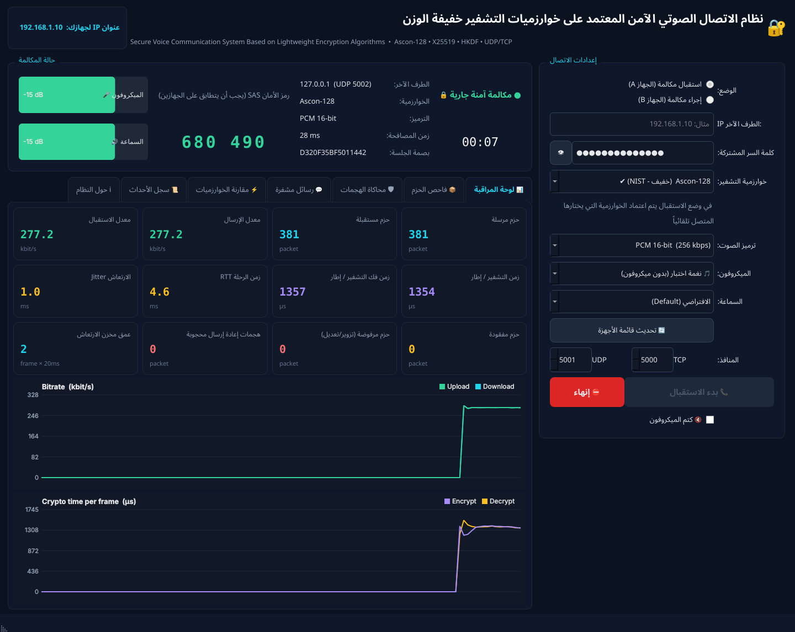
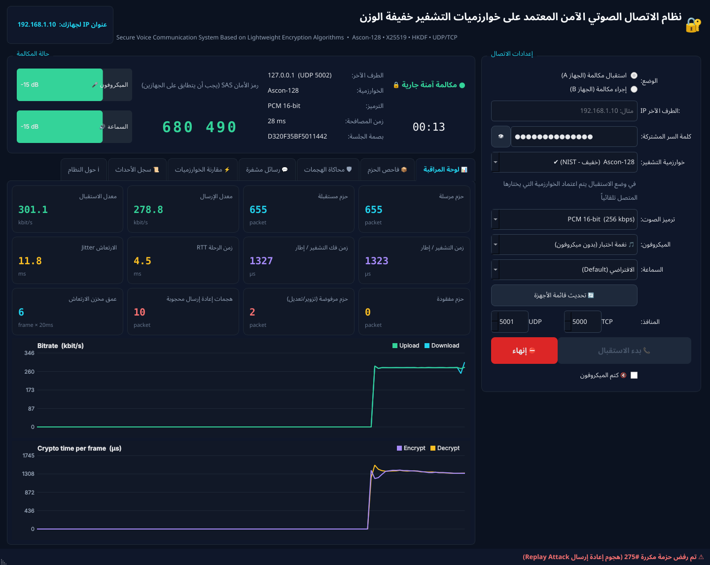
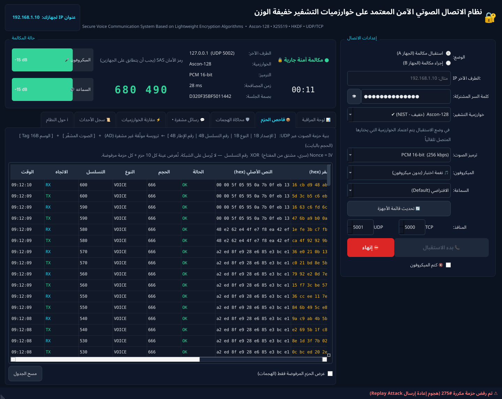
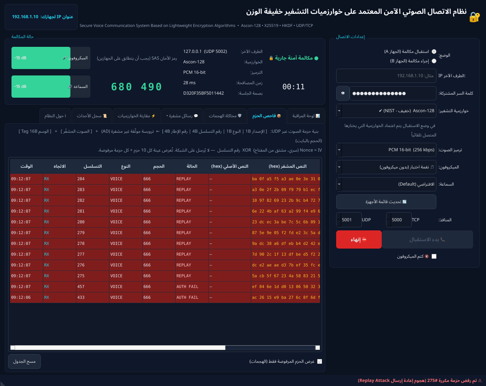
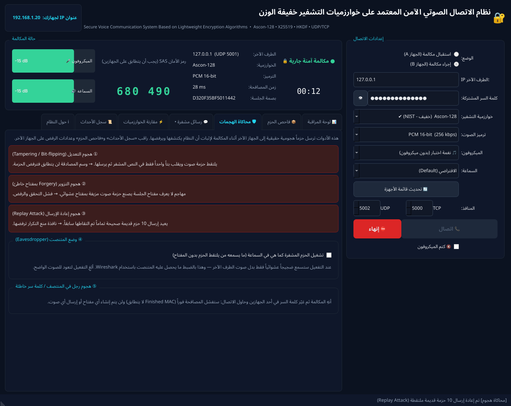
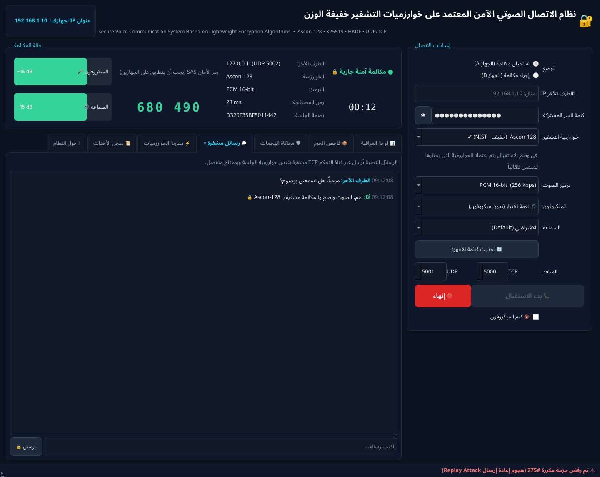
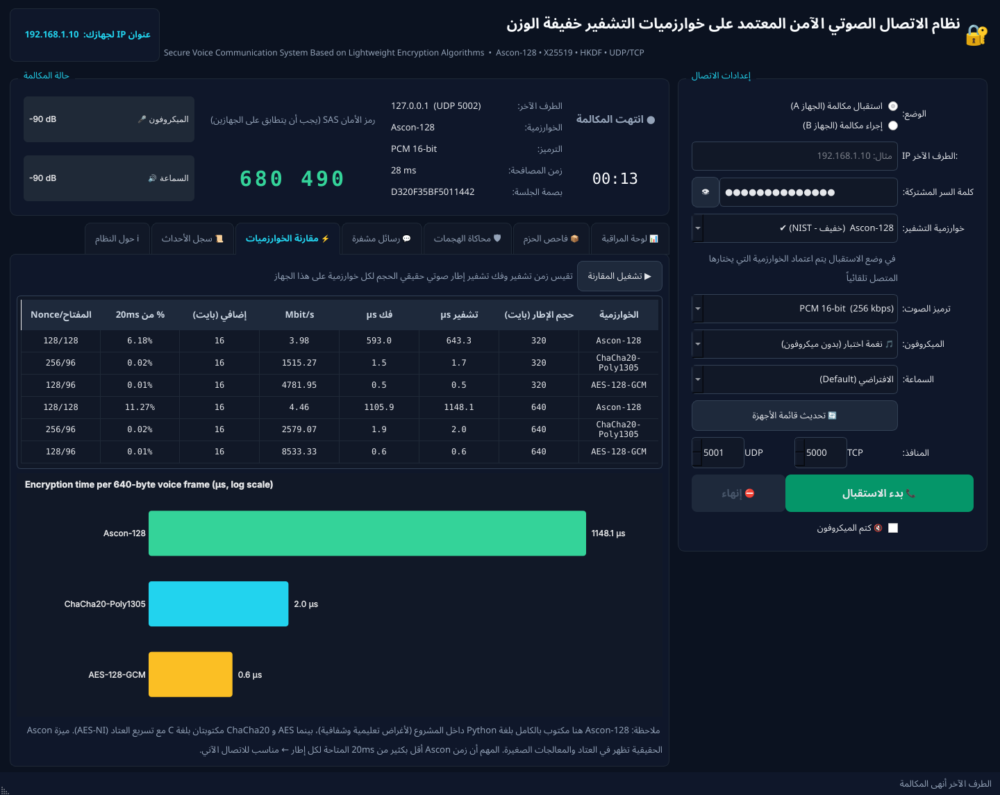
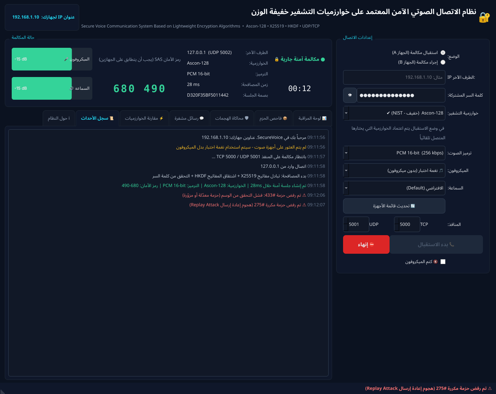
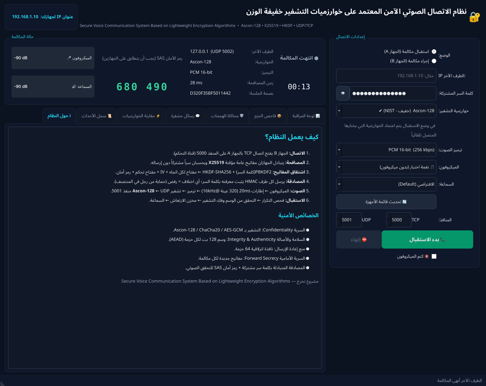

# 7. دليل المستخدم — شرح الواجهة

[⬅ العودة للصفحة الرئيسية](../README.md)

الواجهة مقسمة إلى 4 مناطق:

| المنطقة | المكان | المحتوى |
|---|---|---|
| ① الترويسة | أعلى الشاشة | اسم النظام + **عنوان IP لجهازك** (أعطه للطرف الآخر) |
| ② إعدادات الاتصال | يمين الشاشة | الوضع، IP، كلمة السر، الخوارزمية، الترميز، الأجهزة، المنافذ، أزرار البدء والإنهاء والكتم |
| ③ حالة المكالمة | أعلى المنطقة اليسرى | الحالة، المؤقت، معلومات الجلسة، **رمز الأمان**، مؤشرات الصوت |
| ④ التبويبات | أسفل المنطقة اليسرى | 7 تبويبات للمراقبة والتحليل والعرض |

## 7.1 إعدادات الاتصال

| العنصر | الشرح |
|---|---|
| **الوضع** | «استقبال مكالمة (A)»: ينتظر الاتصال. «إجراء مكالمة (B)»: يتصل بالـ IP المحدد |
| **IP الطرف الآخر** | يُفعّل في وضع الاتصال فقط |
| **كلمة السر المشتركة** | يجب أن تكون متطابقة في الجهازين. زر 👁 لإظهارها |
| **خوارزمية التشفير** | يختارها المتصل؛ المستقبل يعتمدها تلقائياً ويعرضها بعد الاتصال |
| **ترميز الصوت** | PCM 16-bit (جودة كاملة) أو G.711 μ-law (نصف عرض النطاق) |
| **الميكروفون / السماعة** | قائمة أجهزة الصوت، أو «🎵 نغمة اختبار» بدل الميكروفون |
| **المنافذ** | TCP 5000 و UDP 5001 افتراضياً. غيّر UDP إلى 5002 عند التجربة على جهاز واحد |
| **📞 بدء / ⛔ إنهاء** | الإعدادات تُقفل أثناء المكالمة |
| **🔇 كتم الميكروفون** | يرسل صمتاً مشفراً ويُعلم الطرف الآخر |

## 7.2 حالة المكالمة

- **الحالة الملونة:** رمادي (غير متصل)، أصفر (انتظار/اتصال)، بنفسجي (مصافحة)، أخضر (مكالمة آمنة).
- **المؤقت:** مدة المكالمة.
- **الطرف الآخر / الخوارزمية / الترميز / زمن المصافحة / بصمة الجلسة.**
- **رمز الأمان SAS:** 6 أرقام مشتقة من مفاتيح الجلسة. **إذا تطابق على الجهازين فلا يوجد وسيط.** اقرأه بصوتك للطرف الآخر.
- **🎤 / 🔊:** مستوى صوت الميكروفون والسماعة بالديسيبل.

## 7.3 تبويب «📊 لوحة المراقبة»

| البطاقة | المعنى |
|---|---|
| حزم مرسلة / مستقبلة | عدد حزم الصوت (≈ 50 في الثانية) |
| معدل الإرسال / الاستقبال | kbit/s شاملاً ترويسات IP/UDP (≈ 280 لـ PCM16) |
| زمن التشفير / فك التشفير لكل إطار | بالميكروثانية — الدليل الحي على خفة الخوارزمية |
| زمن الرحلة RTT | ذهاب وإياب عبر PING/PONG المشفر |
| الارتعاش Jitter | تذبذب زمن الوصول (RFC 3550) |
| حزم مفقودة | إطارات لم تصل في وقتها (أُخفيت بـ PLC) |
| **حزم مرفوضة** | حزم فشل التحقق من وسمها (تعديل/تزوير) — 🔴 |
| **هجمات إعادة إرسال محجوبة** | حزم مكررة رفضتها النافذة — 🔴 |
| عمق مخزن الارتعاش | عدد الإطارات المنتظرة (كل إطار 20ms) |

ورسمان حيّان: **معدل البت** (إرسال/استقبال) و**زمن التشفير** (تشفير/فك).

## 7.4 تبويب «📦 فاحص الحزم»

يعرض عينة كل 10 حزم + **كل حزمة مرفوضة** (بخلفية حمراء):
الوقت، الاتجاه (TX/RX)، رقم التسلسل، النوع، الحجم بالبايت، **الحالة** (OK / AUTH FAIL / REPLAY)، **أول 10 بايت من الصوت الأصلي**،
**أول 10 بايت من النص المشفر**، **الوسم**، و**الـ Nonce**.

خيار **«عرض الحزم المرفوضة فقط»** يُظهر الهجمات فقط — مثالي للعرض بعد تنفيذ الهجمات:

> 💡 **للجنة:** لاحظوا أنه حتى عندما يكون الصوت الأصلي صمتاً (أصفاراً `00 00 00...`) فإن النص المشفر عشوائي تماماً ومختلف في كل حزمة.

## 7.5 تبويب «🛡 محاكاة الهجمات»

تُنفّذ من أحد الجهازين **أثناء المكالمة**، والنتيجة تظهر على **الجهاز الآخر**:

| الزر | ماذا يفعل | النتيجة المتوقعة على الطرف الآخر |
|---|---|---|
| ① هجوم التعديل | يرسل نسخة من حزمة صوت بعد قلب **بت واحد** في النص المشفر | «⚠ تم رفض حزمة: فشل التحقق من الوسم» + عداد الحزم المرفوضة +1 |
| ② هجوم التزوير | يصنع حزمة صوت مشفرة **بمفتاح عشوائي** (مهاجم لا يعرف المفتاح) | نفس الرفض |
| ③ هجوم إعادة الإرسال | يعيد إرسال 10 حزم قديمة **صحيحة تماماً** | «⚠ تم رفض حزمة مكررة» + عداد الإعادة +10 |
| ④ وضع المتنصت | (يُفعّل على المستقبل) يشغّل البايتات المشفرة في السماعة بدل الصوت المفكوك | تسمع **ضجيجاً** = ما يسمعه من يلتقط الحزم |
| ⑤ كلمة سر خاطئة | أنهِ المكالمة وغيّر كلمة السر في جهاز واحد ثم اتصل | فشل المصافحة على الطرفين، لا صوت |

**في كل الحالات المكالمة الأصلية تستمر دون أي تأثير.**

## 7.6 تبويب «💬 رسائل مشفرة»

رسائل نصية (تدعم العربية والرموز التعبيرية) تُشفّر بنفس الخوارزمية وبمفتاح تحكم منفصل وتنتقل عبر TCP.

## 7.7 تبويب «⚡ مقارنة الخوارزميات»

زر «▶ تشغيل المقارنة» يقيس على **الجهاز الحالي** زمن تشفير وفك تشفير إطار صوتي (320 و 640 بايت) لكل خوارزمية،
ويعرض: الزمن بالميكروثانية، الإنتاجية Mbit/s، الحجم الإضافي (16 بايت)، **النسبة من زمن الإطار 20ms**، وحجم المفتاح/الـ Nonce،
مع رسم أعمدة لوغاريتمي.

## 7.8 تبويب «📜 سجل الأحداث»

كل ما يحدث بالترتيب الزمني وبالألوان: رمادي (معلومات)، أخضر (نجاح)، أصفر (تحذير)، أحمر (خطأ أو هجوم).

## 7.9 تبويب «ℹ حول النظام»

ملخص طريقة العمل والخصائص الأمنية — مفيد كشريحة شرح سريعة أثناء العرض.

