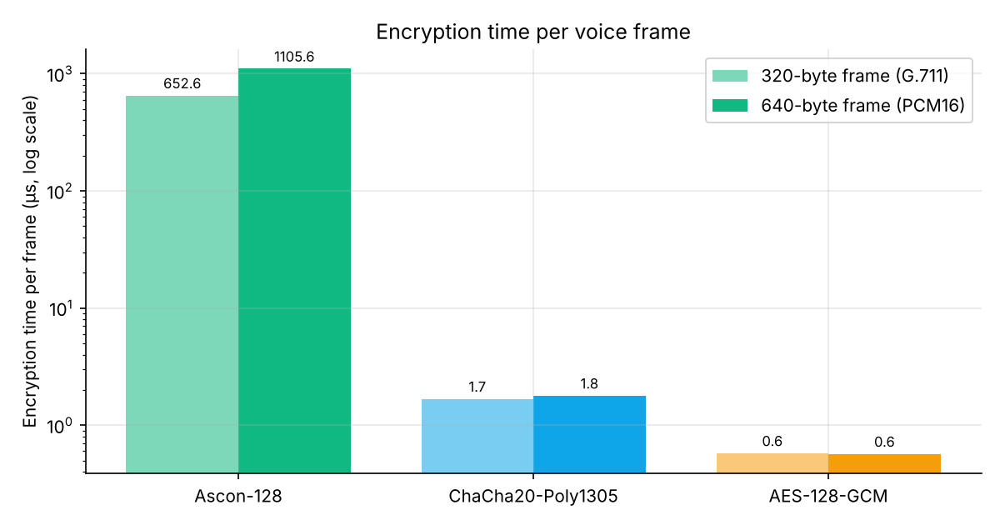
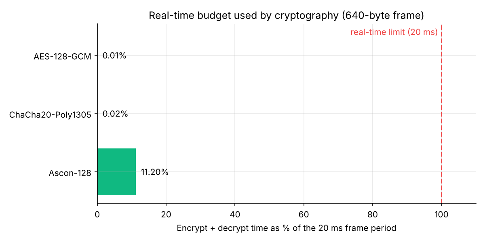
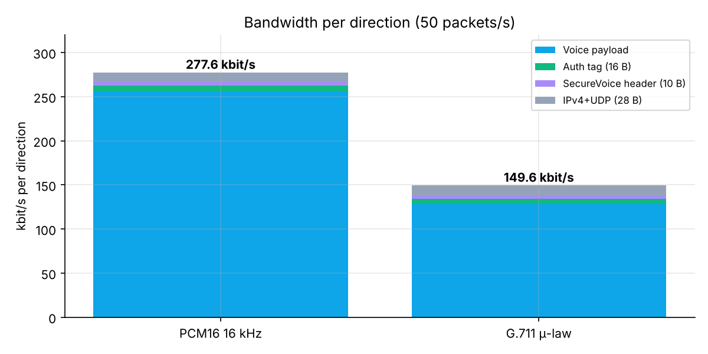
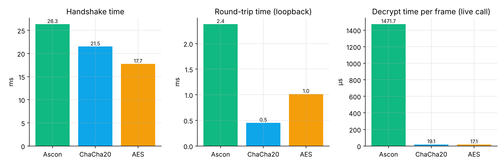
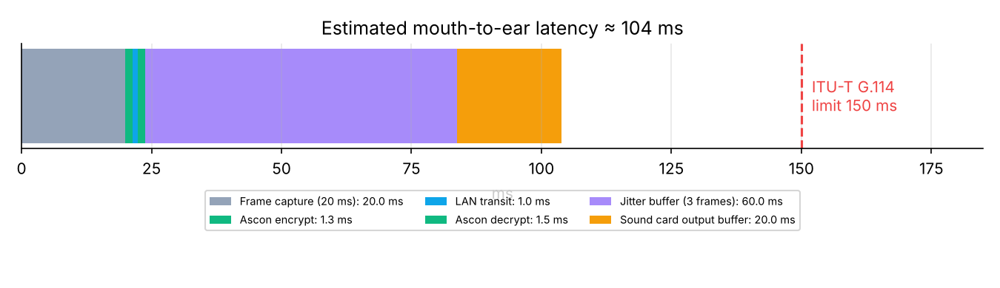

<div dir="rtl">

# 8. الاختبارات والنتائج

[⬅ العودة للصفحة الرئيسية](../README.md)

## 8.1 تشغيل الاختبارات

</div>

```bash
python -m pytest -v
```

<div dir="rtl">

(أو `run_tests.bat` على Windows). النتيجة: **48 passed** ✅ في ≈ 15 ثانية.
وتعمل تلقائياً على **Windows و Linux** في GitHub Actions عند كل تحديث للمستودع.

## 8.2 قائمة الاختبارات

### أ) خوارزمية Ascon-128 — `tests/test_ascon.py` (20 اختباراً)

| الاختبار | ماذا يثبت |
|---|---|
| `test_known_answer_vectors` ×3 | المطابقة مع **متجهات الاختبار الرسمية** لـ Ascon-128 v1.2 (KAT) |
| `test_roundtrip_lengths` ×11 | التشفير ثم فك التشفير يعيد النص الأصلي لأطوال 0..1000 بايت (حالات الحشو الحدّية 7، 8، 9، 15، 16) |
| `test_matches_reference_implementation` | المطابقة بايت ببايت مع التنفيذ المرجعي pyascon لـ 40 حالة عشوائية |
| `test_tamper_ciphertext_rejected` | قلب بت واحد في النص المشفر ← رفض |
| `test_tamper_tag_and_ad_rejected` | تعديل الوسم أو الترويسة (AD) ← رفض |
| `test_wrong_key_or_nonce_rejected` | مفتاح أو Nonce خاطئ ← رفض |
| `test_ciphertext_looks_random` | نفس الصوت (صمت) بـ Nonce مختلف ← نص مشفر مختلف وعشوائي التوزيع |
| `test_invalid_sizes` | رفض المفاتيح والـ Nonce بأطوال خاطئة |

### ب) طبقات التشفير والمصافحة — `tests/test_crypto_layers.py` (11 اختباراً)

| الاختبار | ماذا يثبت |
|---|---|
| `test_cipher_roundtrip_and_auth` ×3 | كل خوارزمية: تشفير/فك صحيح + رفض التعديل + رفض تغيير AD |
| `test_nonce_unique_per_sequence` | 9,999 رقم تسلسل ← 9,999 Nonce مختلف |
| `test_replay_window` | قبول الجديد والمتأخر داخل النافذة، رفض المكرر والقديم جداً |
| `test_handshake_success_derives_matching_keys` ×3 | لكل خوارزمية: نفس رمز الأمان، مفتاح إرسال كل طرف = مفتاح استقبال الآخر، مفاتيح مختلفة لكل اتجاه |
| `test_handshake_fresh_keys_each_call` | **السرية الأمامية**: مكالمتان بنفس كلمة السر ← مفاتيح مختلفة |
| `test_handshake_wrong_password_fails_both_sides` | كلمة سر خاطئة ← فشل على الطرفين ولا مفاتيح |
| `test_handshake_rejects_garbage` | بيانات عشوائية (مثل طلب HTTP) ← رفض |

### ج) الصوت والحزم — `tests/test_audio.py` (6 اختبارات)

| الاختبار | ماذا يثبت |
|---|---|
| `test_pcm_codec_lossless` | PCM بلا فقد |
| `test_ulaw_codec_halves_size_and_low_error` | μ-law: نصف الحجم و SNR > 30 dB |
| `test_level_db` | حساب مستوى الصوت |
| `test_jitter_reorders_and_conceals` | إعادة الترتيب + إخفاء الإطار المفقود + إهمال المتأخر |
| `test_jitter_prebuffer_returns_silence` | التعبئة الأولية |
| `test_packet_header_roundtrip` | بناء وتحليل الترويسة ورفض الحزم المشوهة |

### د) مكالمات حقيقية عبر الشبكة — `tests/test_end_to_end.py` (10 اختبارات)

جلستان حقيقيتان تتصلان عبر `127.0.0.1` بـ **TCP و UDP حقيقيين وتشفير حقيقي**، مع مصدر صوت اصطناعي:

| الاختبار | ماذا يثبت |
|---|---|
| `test_full_call_voice_delivered_bit_exact` ×3 | لكل خوارزمية: المكالمة تنجح، رمز الأمان متطابق، > 40 حزمة، والصوت الذي شُغّل في A **مطابق بت ببت** لما التقطه B والعكس |
| `test_ulaw_codec_call` | مكالمة بترميز μ-law |
| `test_attacks_are_detected_and_blocked` | التعديل والتزوير والإعادة تُكتشف وتُرفض، والمكالمة **تستمر** |
| `test_encrypted_chat_and_mute` | رسائل عربية ورموز تعبيرية في الاتجاهين + الكتم |
| `test_wrong_password_no_call` | كلمة سر خاطئة ← لا مكالمة وخطأ على الطرفين |
| `test_eavesdrop_mode_plays_noise` | وضع المتنصت يعطي ضجيجاً لا يطابق الصوت الأصلي |
| `test_cancel_listening` | إلغاء الانتظار |
| `test_connect_to_nobody_reports_error` | الاتصال بعنوان لا يستمع ← رسالة خطأ |

### هـ) الواجهة — `tests/test_gui.py` (1 اختبار)
نافذتا برنامج حقيقيتان تُجريان مكالمة: رمز الأمان متطابق في الواجهتين، والعدادات تتحدث، والإنهاء يعمل.

## 8.3 قياس أداء الخوارزميات (Micro-benchmark)

</div>

```bash
python -m securevoice.benchmark
```

<div dir="rtl">

النتائج الكاملة: [`results/benchmark.json`](results/benchmark.json) (المنصة المستخدمة: Linux x86_64، Python 3.13، 400 تكرار).
**الأرقام تختلف حسب الجهاز** — شغّل المقارنة من البرنامج على جهازك للحصول على أرقامك للتقرير.

| الخوارزمية | الإطار | تشفير (µs) | فك (µs) | Mbit/s | إضافي | % من 20ms |
|---|---|---|---|---|---|---|
| Ascon-128 | 320 | ≈ 630 | ≈ 610 | ≈ 4 | 16 B | ≈ 6% |
| ChaCha20-Poly1305 | 320 | ≈ 1.6 | ≈ 1.6 | ≈ 1590 | 16 B | 0.02% |
| AES-128-GCM | 320 | ≈ 0.5 | ≈ 0.6 | ≈ 4900 | 16 B | 0.01% |
| Ascon-128 | 640 | ≈ 1150 | ≈ 1140 | ≈ 4.4 | 16 B | ≈ 11.5% |
| ChaCha20-Poly1305 | 640 | ≈ 1.9 | ≈ 1.8 | ≈ 2700 | 16 B | 0.02% |
| AES-128-GCM | 640 | ≈ 0.5 | ≈ 0.5 | ≈ 9300 | 16 B | 0.01% |





### تحليل النتائج
1. **جميع الخوارزميات تحقق متطلب الزمن الحقيقي** (أقل بكثير من 100% من زمن الإطار).
2. Ascon هنا **تنفيذ تعليمي بلغة Python خالصة** (≈ 150 سطراً مقروءاً)، بينما AES و ChaCha20 من مكتبة OpenSSL المكتوبة بلغة C والمحسّنة بالتجميع،
   ويستفيد AES من تعليمات المعالج AES-NI. **المقارنة العادلة** بين الخوارزميات تكون بنفس لغة التنفيذ وعلى نفس العتاد.
3. في الأدبيات العلمية (تنفيذات C على المتحكمات الدقيقة بدون AES-NI)، Ascon تنافسي جداً في السرعة ومتفوق في المساحة العتادية والطاقة،
   وهذا سبب اختيار NIST لها.
4. الحجم الإضافي **متساوٍ (16 بايت/حزمة = الوسم)** لأن الـ Nonce لا يُرسل بل يُشتق من رقم التسلسل.
5. يمكن تسريع Ascon في هذا المشروع 50–100 مرة باستخدام تنفيذ C (مثل مكتبة `pyascon` المترجمة أو Cython) — عمل مستقبلي.

## 8.4 عرض النطاق



| الترميز | الحزمة | مع IP/UDP | لكل اتجاه |
|---|---|---|---|
| PCM16 | 666 B | 694 B | **277.6 kbit/s** |
| G.711 μ-law | 346 B | 374 B | **149.6 kbit/s** |

نسبة الحمل الإضافي الأمني (Tag 16 + Header 10 = 26 بايت): ≈ 3.7% مع PCM16.

## 8.5 مكالمات حقيقية (10 ثوانٍ لكل خوارزمية)

</div>

```bash
python tools/make_charts.py
```

<div dir="rtl">

النتائج: [`results/e2e_results.json`](results/e2e_results.json)

| الخوارزمية | المصافحة | حزم مستقبلة | مفقودة | مرفوضة | إطارات مطابقة بت ببت | RTT | Jitter |
|---|---|---|---|---|---|---|---|
| Ascon-128 | ≈ 26 ms | 501 | **0** | 0 | 499 ✅ | ≈ 2.4 ms | ≈ 0.2 ms |
| ChaCha20-Poly1305 | ≈ 21 ms | 502 | **0** | 0 | 499 ✅ | ≈ 0.5 ms | ≈ 0.2 ms |
| AES-128-GCM | ≈ 18 ms | 502 | **0** | 0 | 499 ✅ | ≈ 1.0 ms | ≈ 0.3 ms |

(الفرق بين 501 و 499 = أول إطارين ما زالا في مخزن الارتعاش لحظة القياس.)



> زمن التشفير المقاس **أثناء المكالمة** أعلى قليلاً من القياس المعزول لأن عدة خيوط (الصوت، الإرسال، الاستقبال، جلستان على نفس الجهاز) تتشارك المعالج.

## 8.6 ميزانية التأخير



التأخير الكلي التقديري ≈ **104 ms** < **150 ms** (ITU-T G.114) ✅، ومساهمة التشفير وفك التشفير ≈ 2.7 ms فقط.

## 8.7 اختبارات الأمان (محاكاة الهجمات)

| الهجوم | عدد المحاولات في الاختبار | المرفوض | النسبة |
|---|---|---|---|
| تعديل بت واحد في النص المشفر | 1+ | الكل | 100% |
| تعديل الوسم | 1 | الكل | 100% |
| تعديل الترويسة (AD) | 1 | الكل | 100% |
| تزوير بمفتاح عشوائي | 1+ | الكل | 100% |
| إعادة إرسال حزم قديمة | 10 | 10 | 100% |
| كلمة سر خاطئة في المصافحة | 1 | الكل | 100% |
| بيانات عشوائية بدل المصافحة | 1 | الكل | 100% |

## 8.8 اختبار يدوي مقترح على جهازين (للتقرير)

| # | السيناريو | المتوقع | النتيجة |
|---|---|---|---|
| 1 | مكالمة 5 دقائق بـ Ascon-128 على Wi-Fi | صوت واضح، فقد < 1% | ☐ |
| 2 | نفس الشيء بـ ChaCha20 و AES-GCM | مقارنة العدادات | ☐ |
| 3 | ترميز μ-law | عرض نطاق ≈ 150 kbit/s | ☐ |
| 4 | Wireshark على `udp.port == 5001` | بيانات عشوائية، لا صوت مقروء | ☐ |
| 5 | الهجمات ①②③ من التبويب | رفض 100% واستمرار المكالمة | ☐ |
| 6 | وضع المتنصت | ضجيج | ☐ |
| 7 | كلمة سر خاطئة | فشل المصافحة | ☐ |
| 8 | فصل الشبكة أثناء المكالمة | تحذير ثم إنهاء | ☐ |

## 8.9 التحقق باستخدام Wireshark (خطوات)

1. ثبّت Wireshark من <https://www.wireshark.org> (مع Npcap).
2. اختر واجهة Wi-Fi واكتب الفلتر: `udp.port == 5001`.
3. ابدأ مكالمة. ستظهر حزم بطول 666 بايت بمعدل 50/ثانية لكل اتجاه.
4. اختر حزمة ← البايتات بعد أول 10 تبدو عشوائية.
5. **Telephony ← RTP ← Stream Analysis** لن يتعرف عليها كصوت لأنها مشفرة.
6. للمقارنة: الفلتر `tcp.port == 5000` يظهر المصافحة: `SVC1` ثم مفاتيح X25519 العامة (عامة بطبيعتها، لا خطر منها).

</div>
