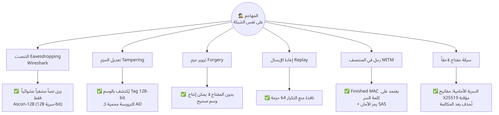

# 9. التحليل الأمني

[⬅ العودة للصفحة الرئيسية](../README.md)

## 9.1 نموذج التهديد (Threat Model)

**المهاجم المفترض:** شخص على **نفس الشبكة** (Wi-Fi مشترك أو جهاز مخترق في الشبكة) يستطيع:
- قراءة كل الحزم (Passive eavesdropper).
- حقن حزم وتعديلها وحذفها وإعادة إرسالها (Active attacker — نموذج Dolev-Yao).
- الوقوف بين الجهازين (MITM) عبر ARP spoofing مثلاً.

**الافتراضات:** الجهازان نفسيهما غير مخترقين، وكلمة السر المشتركة تم الاتفاق عليها بطريقة آمنة (وجهاً لوجه) وليست سهلة التخمين.

## 9.2 الهجمات والدفاعات

| # | الهجوم | الدفاع في النظام | كيف تثبته أمام اللجنة |
|---|---|---|---|
| 1 | **التنصت** على الصوت | Ascon-128 بمفتاح 128 بت لكل اتجاه | Wireshark + «وضع المتنصت» (ضجيج) |
| 2 | **تعديل** الحزم (Bit-flipping) | وسم AEAD 128 بت؛ احتمال تزوير وسم صحيح ≈ 2⁻¹²⁸ | زر «هجوم التعديل» ← AUTH FAIL |
| 3 | **تعديل الترويسة** (مثلاً تغيير رقم التسلسل) | الترويسة = Associated Data موثّقة، وتدخل في الـ Nonce | اختبار `test_tamper_tag_and_ad_rejected` |
| 4 | **حقن/تزوير** حزم | بدون المفتاح لا يمكن إنتاج وسم صحيح | زر «هجوم التزوير» |
| 5 | **إعادة الإرسال** Replay | رقم تسلسل + نافذة انزلاقية 64 | زر «هجوم إعادة الإرسال» ← REPLAY |
| 6 | **الانعكاس** Reflection (إعادة حزمة A إلى A) | مفتاح مختلف لكل اتجاه | — |
| 7 | **رجل في المنتصف** MITM | PSK من كلمة السر داخل اشتقاق المفاتيح + Finished MAC + رمز الأمان SAS | كلمة سر خاطئة ← فشل |
| 8 | **خفض الخوارزمية** Downgrade | transcript hash في الاشتقاق + التحقق من صدى المعاملات | — |
| 9 | **سرقة المفاتيح لاحقاً** | X25519 مؤقت لكل مكالمة ← سرية أمامية | `test_handshake_fresh_keys_each_call` |
| 10 | **تخمين كلمة السر** Online | كل محاولة = مصافحة كاملة مرئية في السجل | — |
| 11 | **تخمين كلمة السر** Offline | PBKDF2 100,000 تكرار يبطئ كل محاولة | — |
| 12 | **هجمات التوقيت** | مقارنة الوسوم و MAC بزمن ثابت؛ Ascon بلا جداول بحث | — |
| 13 | **إعادة استخدام الـ Nonce** | Nonce = IV ⊕ seq مع عداد لا يتكرر وإيقاف قبل الالتفاف | `test_nonce_unique_per_sequence` |

## 9.3 خصائص الأمان المحققة

| الخاصية | ✅ |
|---|---|
| Confidentiality — السرية | ✅ |
| Integrity — السلامة | ✅ |
| Data-origin Authentication — أصالة المصدر | ✅ |
| Mutual Entity Authentication — مصادقة متبادلة | ✅ (بكلمة السر) |
| Replay Protection — منع إعادة الإرسال | ✅ |
| Perfect Forward Secrecy — السرية الأمامية | ✅ |
| Key Separation — فصل المفاتيح (اتجاهات + تحكم + تأكيد) | ✅ |

## 9.4 القيود (بأمانة علمية) وكيف تُحل مستقبلاً

| القيد | التوضيح | الحل المستقبلي |
|---|---|---|
| كلمة سر ضعيفة | مهاجم نشط سجّل مصافحة يمكنه تجربة كلمات سر offline (مع PBKDF2 يصبح أبطأ لكن ممكناً لكلمات قصيرة) | بروتوكول **PAKE** مثل SPAKE2 / CPace، أو شهادات رقمية |
| تحليل حركة المرور | حجم الحزم ثابت وتوقيتها منتظم ← يمكن معرفة أن هناك مكالمة (لا محتواها) | حشو وحزم وهمية |
| الترويسة مكشوفة | رقم التسلسل مرئي (غير سري، موثّق فقط) | تشفير الترويسة كما في QUIC |
| Python في الذاكرة | لا يمكن ضمان مسح المفاتيح من ذاكرة Python تماماً | تنفيذ النواة بلغة C/Rust |
| لا يوجد تجديد مفاتيح أثناء المكالمة | كافٍ لمكالمات حتى سنوات (2³² حزمة) | Rekey دوري |
| Ascon v1.2 | الإصدار النهائي SP 800-232 فيه تعديلات طفيفة | تحديث `ascon.py` |
| PBKDF2 | Argon2 أقوى ضد العتاد المخصص | Argon2id |

## 9.5 مقارنة مع أنظمة حقيقية

| | SecureVoice | SRTP + DTLS (WebRTC) | Signal / WhatsApp | ZRTP |
|---|---|---|---|---|
| تشفير الوسائط | Ascon-128 / ChaCha20 / AES-GCM (AEAD) | AES-CM + HMAC-SHA1 أو AES-GCM | SRTP بمفاتيح Signal Protocol | SRTP |
| تبادل المفاتيح | X25519 + PSK | ECDHE في DTLS | X3DH / PQXDH + Double Ratchet | DH |
| المصادقة | كلمة سر + SAS | بصمة الشهادة عبر الإشارة | مفاتيح الهوية + رقم الأمان | **SAS** (مثلنا) |
| منع التكرار | نافذة 64 | نافذة (RFC 3711) | نعم | نعم |
| خفيف الوزن | ✅ Ascon | ❌ | ❌ | ❌ |

فكرة رمز الأمان SAS في مشروعنا مستوحاة من بروتوكول **ZRTP** (RFC 6189) الذي صممه Phil Zimmermann.

